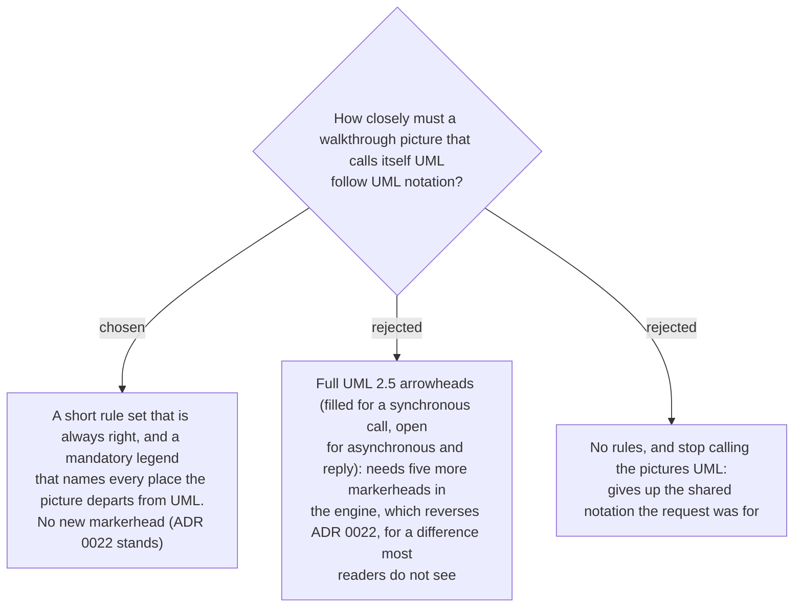

# A picture labelled UML follows a small correct subset and carries a legend

The walkthrough published on 2026-11-20 had two places a reader who knows UML reads wrongly.
One message is a reply, drawn with the same solid line as the call before it. And its
legend says a dashed line means "happening now", where UML uses a
dashed line for a reply. A picture that says "UML" on screen and breaks the notation teaches
the notation wrongly.

**Sequence diagram (the sequence pack).** A lifeline is a head box over a dashed vertical
line. A solid arrow is a message sent or a call. A dashed arrow is a reply. A message from a
lifeline to itself is a self-message. A frame has an operator (`alt`, `opt`, `loop`) and a
guard in square brackets. The state "happening now" is shown by a thicker, glowing line and
never by dashes, so a reply stays dashed in every state and a message stays solid in every
state.

**Class diagram (the kit).** A box has a name compartment, with a stereotype in guillemets
where it helps, and an attribute compartment whose lines read `name : Type = value`. An
association is a solid line with a multiplicity at each end. A dependency is a dashed arrow
with its stereotype.

**Activity diagram (the kit).** An initial node, actions, decisions, a final node. Every
flow out of a decision is a drawn arrow with its guard in square brackets; a branch is not
written as loose text beside the diamond.

**The stated departure.** Every arrow has the same filled head, in one of the engine's five
colours. UML's open head for an asynchronous message and for a reply is not drawn. The
legend says so.

**The legend.** The sequence pack's main diagram always carries a legend: what a lifeline,
a solid arrow, a dashed arrow and a frame mean, what each state colour means, and the
departure above. Every supporting diagram carries a one-line caption that names its type and
says how to read it.

`check-walkthrough.py` can test the form: the legend exists, every message declares its kind
as `call`, `reply` or `self`, every supporting diagram declares its type and has a caption.
It cannot test the meaning. Whether a reply was declared a reply is a line in the skill's
Phase 5 checklist and a row in Common Mistakes.
