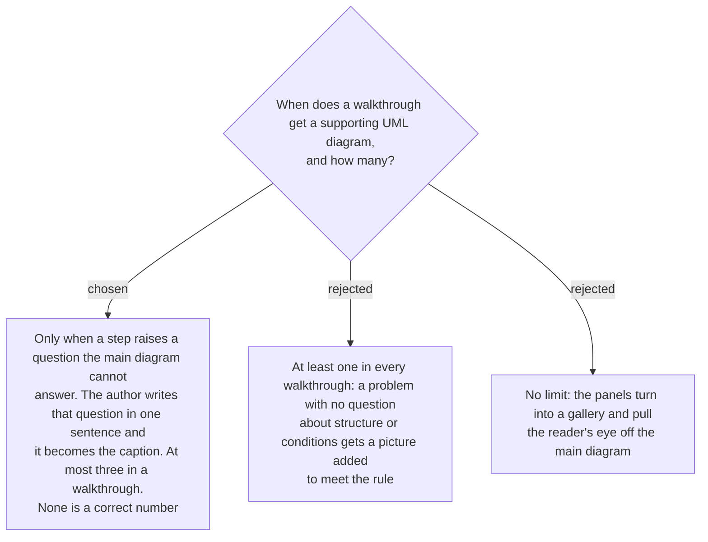

# A supporting diagram must answer a question the main diagram cannot, and three is the most

The walkthrough published on 2026-11-20 had three supporting diagrams in seventeen steps, and each
answered something its sequence diagram could not show: where a field lives (class), what
is checked before a value is given out (activity), and how two ways of keying a record
differ (class). That is the rule. The skill picks the type from the
question:

| The step asks | Supporting diagram |
|---|---|
| what the data looks like, which field holds it, how many to how many | class diagram |
| what is checked, in what order, and where the path splits | activity diagram |

In Phase 1 the author lists each planned supporting diagram with the one-sentence question
it answers. A diagram without such a sentence is not drawn. Three is the most, because that
is what the one real walkthrough needed; a walkthrough with none is complete.
