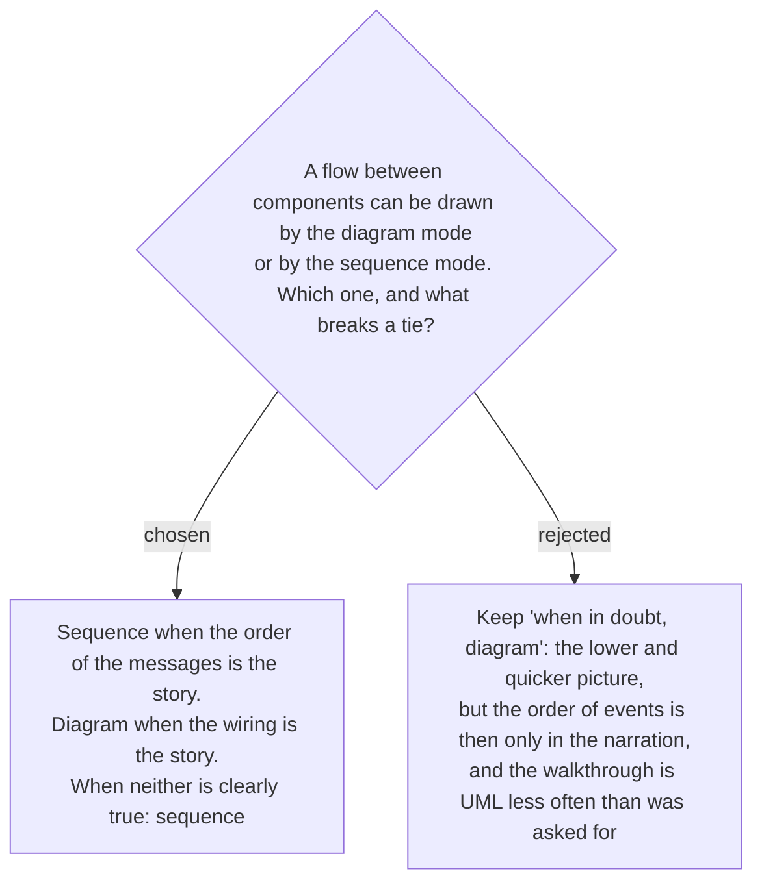

# Between the diagram and sequence modes, a tie goes to sequence

Both modes draw a flow between components, so the mode table needs a rule that an author
can apply without taste.

**Sequence** when the story is who sends what to whom and in what order; each message
happens once; there are twelve messages or fewer. A sequence diagram puts the order on the
picture itself, as position down the page.

**Diagram** when the story is what is wired to what; or one wire fires again and again while
a value builds up inside a box (a counter, a lock, a queue); or there are more than twelve
messages, because a sequence diagram that long does not fit a window.

**A tie goes to sequence.** This replaces the skill's earlier tie-break, "when in doubt →
diagram". The request behind this change was for UML, and in the diagram mode a message that
has already happened only changes colour, so the reader gets the order from the narration.
The price is a taller picture that takes longer to author.

The rule for the other modes does not change: rows changing under FK or cascade rules are
the tables mode, and one entity's legal transitions are the state-machine mode.
