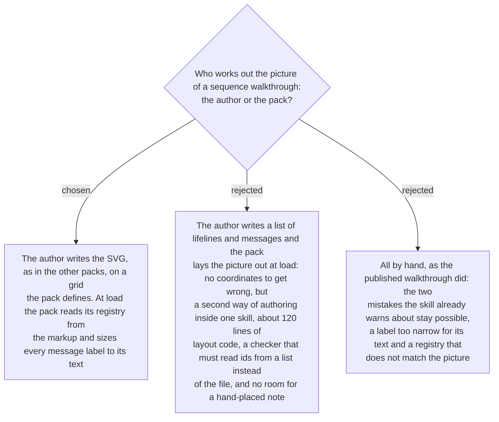

# The sequence pack is authored as SVG on a grid, and reads its registry from the markup

The published sequence walkthrough was written entirely by hand: every coordinate, the width
of every label background (223, 319, 298 and so on, each estimated from the text), and the
list of element ids typed a second time into the registry. The skill's Common Mistakes
already lists two failures of that method. A label background narrower than its text clips
it. A registry that misses an element leaves that element out of `clear()`, and
`assertRegistryComplete()` then throws when the page loads, which `check-walkthrough.py`
does not see because it never runs the page.

The author still writes the SVG. That keeps one way of authoring across the four packs, and
keeps every id in the file, where the checker's scene-id pass reads it. The pack takes over
the two things that went wrong:

- **The registry comes from the markup.** When the pack registers, it collects the ids of
  the lifelines, messages and frames it finds, and the default text of every live value.
  The author types no id list, so the list cannot disagree with the picture.
  `assertRegistryComplete()` keeps its name and its place in the bootstrap; it now checks
  what a list could not get wrong by construction but markup still can: an element without
  an id, a duplicate id, a message without a kind, a missing legend.
- **Labels size themselves.** When the pack registers, it measures each message label and
  sets its background to fit. The author writes no label width.

The grid is part of the pack: where each lifeline stands for a given number of lifelines,
the height of a message row, how a self-message and a frame are placed. It is written once,
in the pack's header comment, and the pack's demo follows it.

The three existing packs keep their hand-typed registries. Changing them is not part of
this work.
