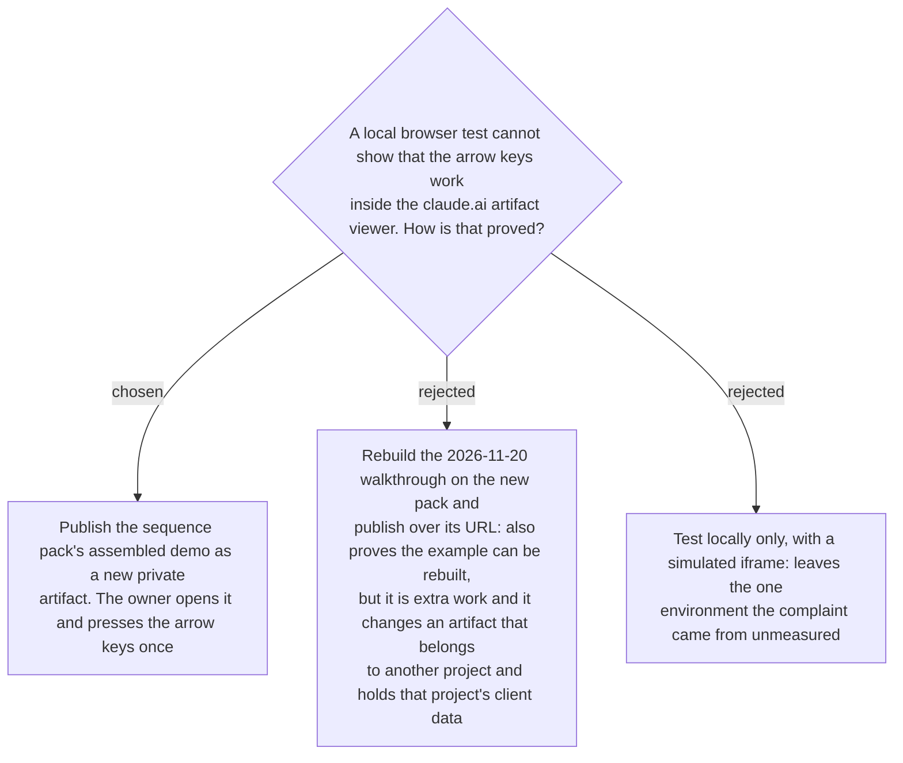

# The arrow keys are proved in the real viewer with a published demo

The complaint that started this work was made about a walkthrough shown in the claude.ai
artifact viewer, which embeds the page in an iframe. Automated tests run in a local browser:
they can prove the listener, the modifier-key guard and the focus hint on a page opened
directly and on a page inside a local iframe. They cannot open the real viewer.

So the last step of the work is a measurement by a person. The sequence pack's demo, which
contains only invented data, is published as a new private artifact, and the owner checks
three things: the hint shows before the first click, the arrow keys step after it, and the
hint is no longer visible. The result is recorded with the work. The 2026-11-20 artifact is not
touched.

Result, 2026-11-22: the sequence demo built from the branch was published as a new private artifact and the owner tried it in the claude.ai viewer: the left and right arrow keys step the walkthrough. (The owner reported the keys; the hint line was not reported on separately.)
