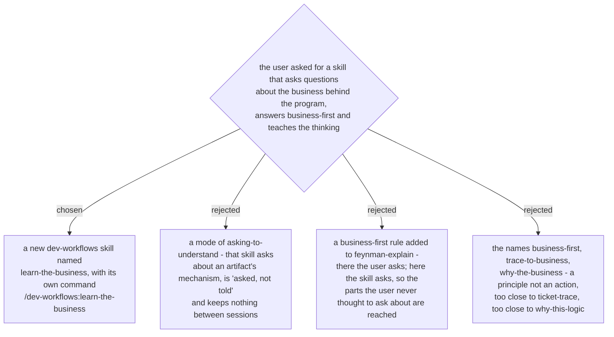

# learn-the-business is its own skill, not a mode of asking-to-understand

Ruled 2026-11-21 by the user (Pon): "สร้างสกิลถามคำถามเกี่ยวกับ business ของสิ่งที่ทำ", then
the name "learn the business". Three things separate it from `asking-to-understand`: the
subject is the business reason, not the mechanism; every question ends in a reveal; and a
note is kept between sessions. The name pairs with `learn-with-flashcard`, which can take
the note as its source.
