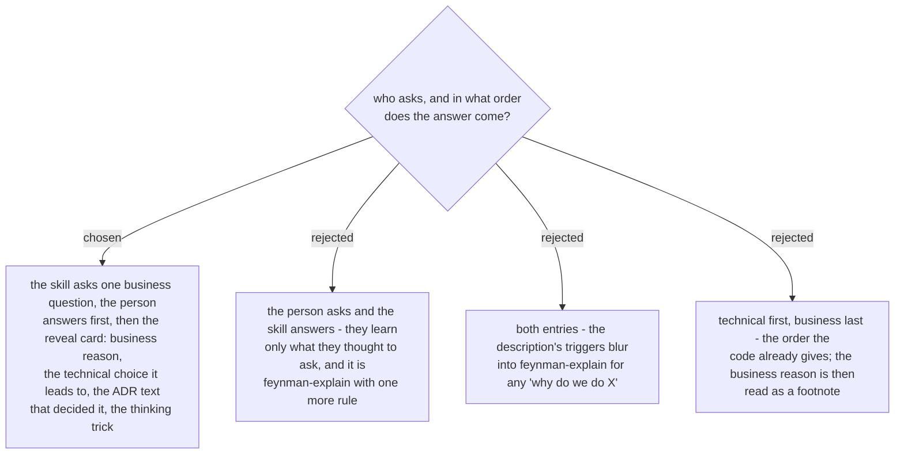

# learn-the-business asks first, and reveals business, then technical, then ADR, then thinking

Ruled 2026-11-21 by the user. Answering before the reveal is what makes the thinking lesson
hold: the person sees where their own reasoning left the method. The card's order is the
user's own wording - business as the lead, then the link to the technical side "ว่าทำไมต้อง
ทำแบบนั้น ประกอบกับข้อความใน adr". A part with no ADR says so on the ADR line.
