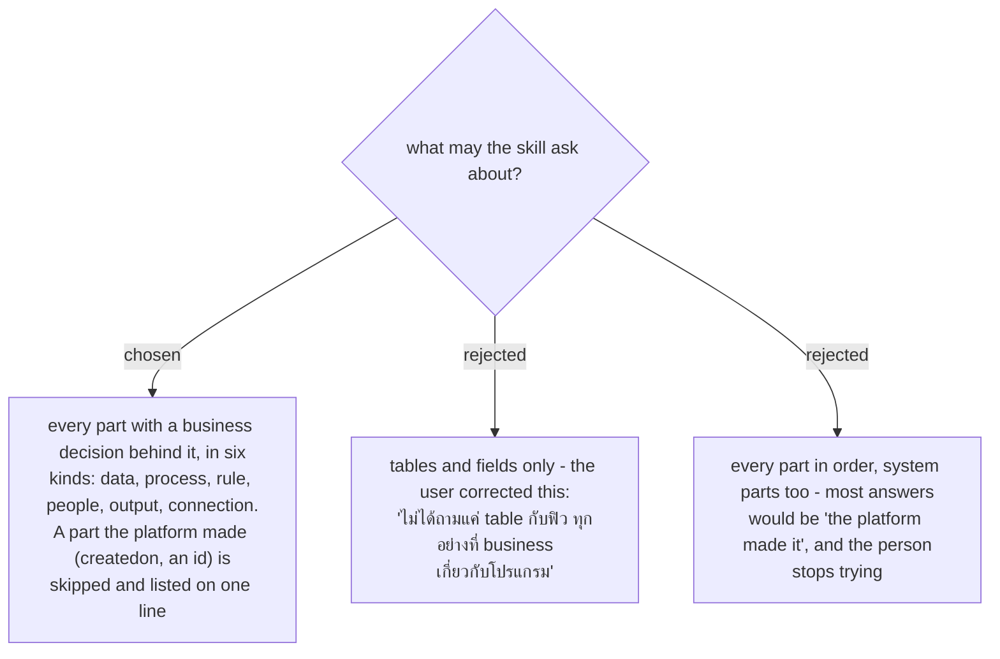

# learn-the-business covers every part of the program that has business behind it

Ruled 2026-11-21 by the user. The six kinds are an open set: data (table, field, choice
value, relationship), process (flow, job, trigger), rule (condition, threshold, validation,
default), people (role, permission, recipient), output (report, email, screen), connection
(external system, API). A part of a new kind is added to the list, not forced into one.
