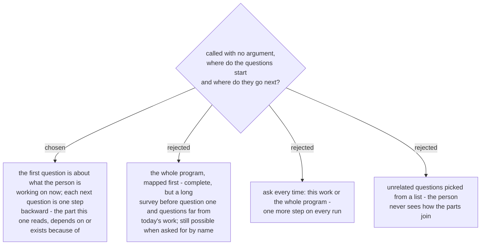

# learn-the-business starts at what the person is touching and walks backward

> **Added to 2026-11-23 by ADR 0389:** the first question is no longer the first thing the
> person sees. The skill now shows the Business flow - three to seven lines around the part -
> before it. What this ADR chose is unchanged, and its rejected "mapped first" branch stays
> rejected: that was a map of the whole program.

Ruled 2026-11-21 by the user: "คำถามแรก เกี่ยวกับสิ่งที่ทำ ไล่ถามส่วนที่เกี่ยวข้องไปเรื่อยๆ
แบบย้อนกลับ". The start is read from the uncommitted changes, the branch's ticket and the
session; the skill names what it picked in its first line, so a wrong pick costs one line.
An argument (a ticket URL, a part's name, "the whole program") always wins.
