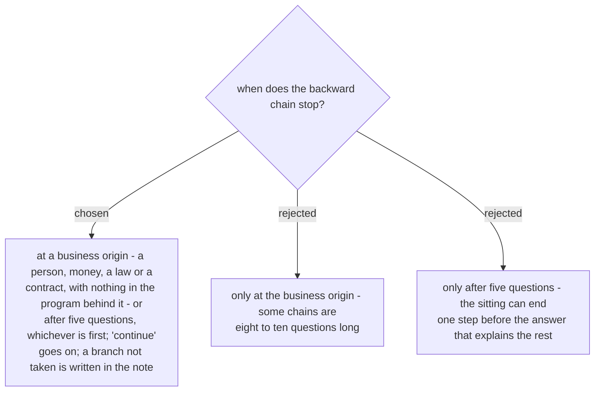

# A learn-the-business chain stops at a business origin or after five questions

Ruled 2026-11-21 by the user. A chain also stops where no source says more; that point is a
question for the client (ADR 0373). The five is borrowed from `practice-english-writing`'s
sitting and rests on no evidence. Where a chain forks, one branch is walked and the others
are noted as not yet asked.
