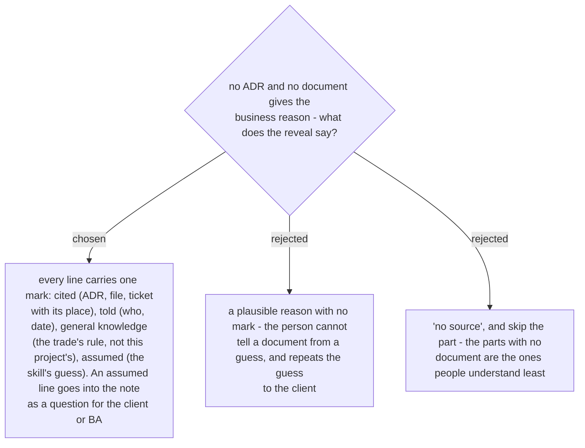

# Every line of a learn-the-business reveal carries one of four source marks

Ruled 2026-11-21 by the user. The search order before any question: ADRs, specs and
documents in the repo, the ticket with its comments and images, `CONTEXT.md`, commit
messages, tests. *cited* and *told* are `why-this-logic`'s words; *general knowledge* is
`feynman-explain`'s. The person's own answer to a part with no source is written as *told*,
never *cited*, and an answer is never judged wrong against an *assumed* line.
