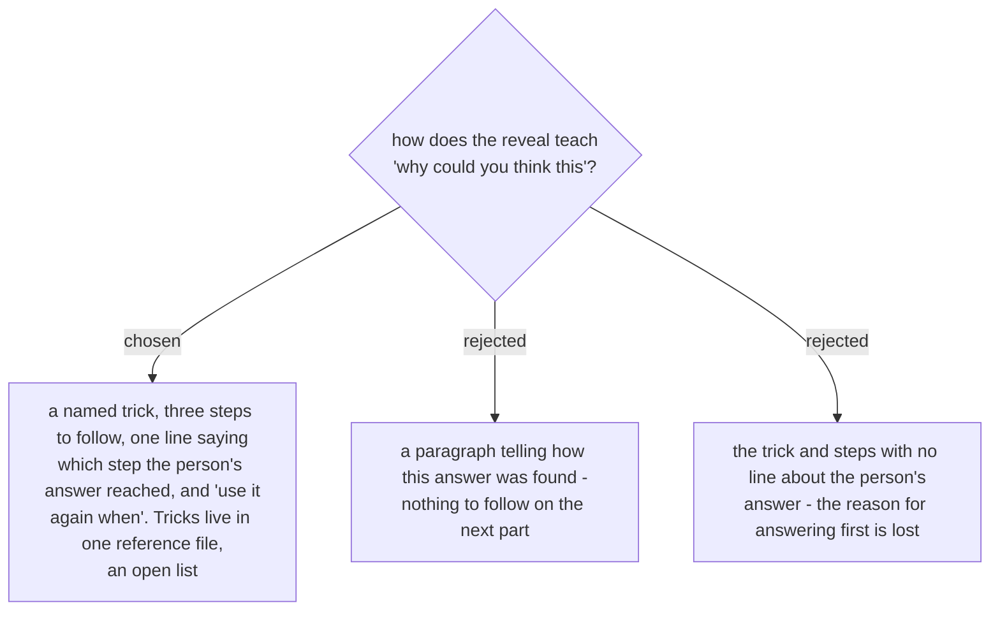

# The thinking slot is a named trick with steps, and the step the answer stopped at

Ruled 2026-11-21 by the user ("how to and trick like dummy"). Starter tricks: who reads this
value, who is hurt if it is gone for a month, how was it done before the system, who set this
number, follow the money. A way of thinking not on the list is added to the file. The whole
card is written at beginner level: short sentences, and a business word gets a short gloss
on first use.
