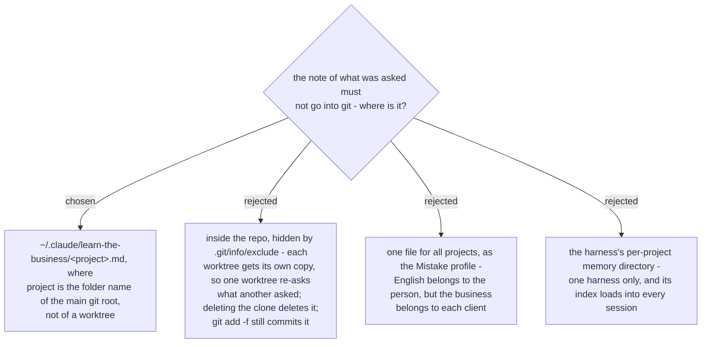

# The business note is one file per project, outside every repo

Ruled 2026-11-21 by the user ("ไม่ต้องเอาเข้า git"). The pattern is ADR 0181's, changed in one
point: one file per project. The skill says the file's full path every time it writes. The
note does not travel to another machine, and it holds client business facts in the home
folder of a machine that already holds the client's repo.
