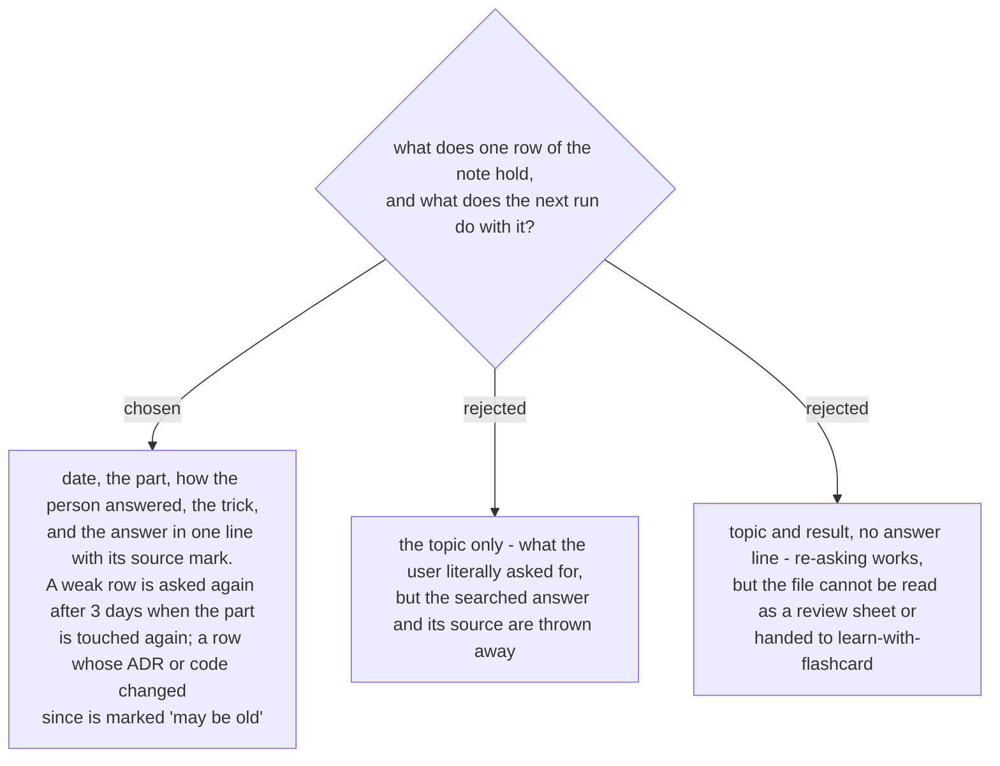

# The business note keeps the topic, the result, the trick and a one-line answer

Ruled 2026-11-21 by the user. The file has two more lists, from ADRs 0372 and 0373: branches
not yet asked, and questions for the client or BA. It is Markdown, the person may edit it,
and their edit wins. The 3 days rest on no evidence.
