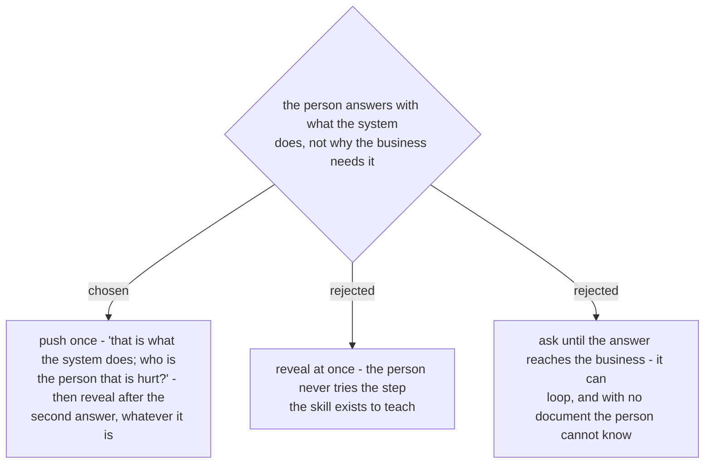

# An answer that describes the system is pushed once toward the business

Ruled 2026-11-21 by the user. It is `asking-to-understand`'s "symptom, not mechanism" move
with the pair changed to system and business. The other classes get no push: right - confirm
and go on; half right - name the right half and add the other; wrong - reveal with the
source, the verdict on the answer and never on the person; does not know - reveal, and do
not ask again this sitting.
