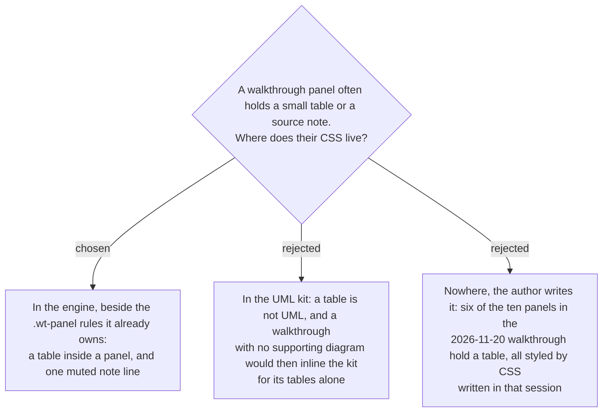

# The walkthrough engine styles a table and a note inside a panel

The engine owns `.wt-panel`, its title and its three variants (ADR 0020). It said nothing
about what goes inside. In the one published sequence walkthrough, six of ten panels held a
table and most held a muted line naming the source of a figure; the session wrote
`.wt-panel table`, `.tbl-wrap` and `.ex` for them.

Those rules move into the engine's §CSS, using only `:root` tokens: a table inside a panel
(with a wrapper that scrolls sideways on a narrow page) and a note line, `.wt-note`. Every
mode gets them. In the tables mode the pack's own `table` rules still style the main
diagram; the panel rule is more specific and applies only inside a panel.

With this, the UML kit (ADR 0361) and the sequence pack (ADR 0360), a walkthrough like the
published one needs no CSS of its own. The skill states that as a rule: a walkthrough adds
no CSS; a style that is missing belongs in a reference.
