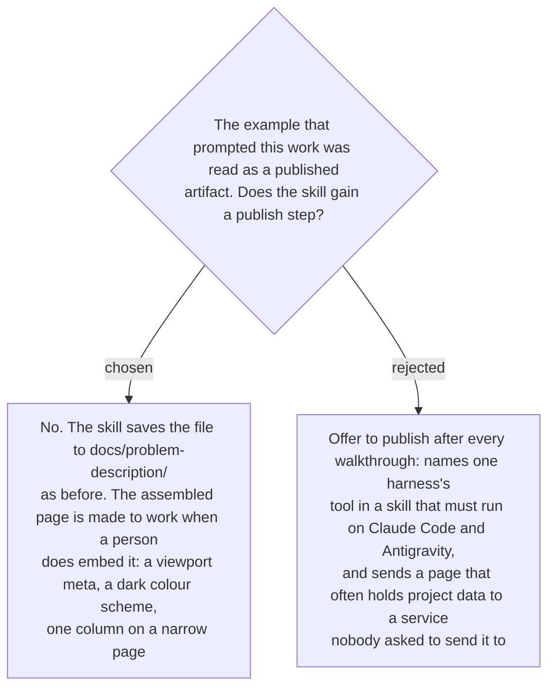

# The skill still only saves a file, and the page is built to fit an embedded viewer

Publishing a walkthrough is something a person asks for, one walkthrough at a time, in a
harness that can do it. The skill's contract stays what it was: one self-contained file in
the open project.

What the skill can do is make that file behave when it is embedded. The assembler writes a
`<meta name="viewport">` into the page, so a phone or a narrow panel does not lay it out at
desktop width. The engine's `:root` declares `color-scheme: dark`, so scrollbars and form
controls match the page. The sequence pack's two columns become one below 1300px, the width
at which the diagram column would get narrower than the diagram's minimum, and its diagram
scrolls sideways inside its own box so the page never does. The arrow-key hint (ADR
0357) covers the one behaviour an embedded page cannot fix by itself.
