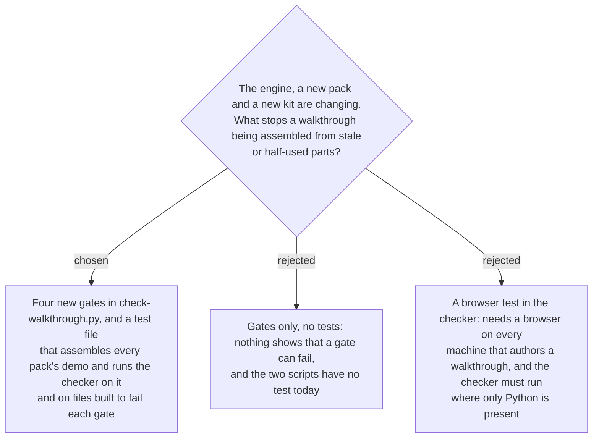

# check-walkthrough gains four gates, and the two walkthrough scripts get tests

`check-walkthrough.py` is the only safety net between assembly and the reader, and it is
static: it reads the assembled file and never runs it. It gains four gates.

1. **Keyboard.** The assembled script holds the engine's `keydown` listener and both arrow
   key names. Fails a walkthrough assembled from an engine copy that predates ADR 0356.
2. **Controls first.** The Previous button comes before the narration in the file. Fails an
   engine copy that predates ADR 0358.
3. **UML kit.** A kit class in the page needs the kit's CSS, and the kit's CSS needs at
   least one kit picture. Every picture declares its type and has a caption. There are at
   most three pictures (ADRs 0361, 0363, 0364).
4. **Sequence.** In the sequence mode the legend exists and every message declares its kind
   as `call`, `reply` or `self` (ADR 0363). The scene-id pass learns the sequence setters and
   reads ids from an array argument as well as from a string, so a mistyped id in either
   form still fails.

Neither `assemble-walkthrough.py` nor `check-walkthrough.py` has a test (measured
2026-11-21: no `test_*walkthrough*` file in the repo). A test file is added in
`plugins/dev-workflows/scripts/`, where the plugin's other script tests live. It assembles
the demo of each of the four packs and expects the checker to pass, and it builds one broken
file per gate and expects the checker to fail with that gate's message.

The behaviour a static check cannot see, such as a key press actually moving the step, was
measured once in a browser while this was designed and is measured again in the real viewer
at the end of the work (ADR 0367).
