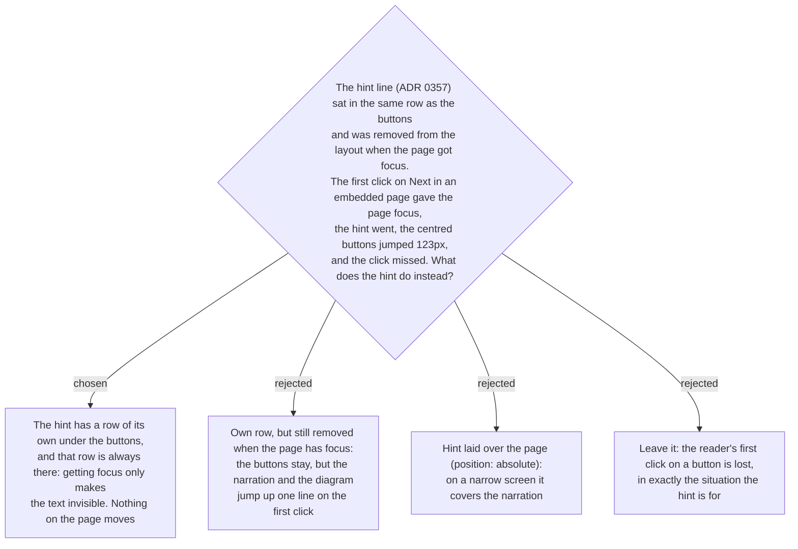

# The arrow-key hint keeps its own row and its room, so the buttons never move under a click

Measured on the Task 2 engine inside an iframe 900px wide, with a real mouse press and
release on Next: before the press the page had no focus, the hint was visible and Next
was at x 283-381; the press gave the page focus, the hint was removed, Next moved to
x 406-504; the release landed beside the button, no `click` fired and the walkthrough
stayed on step 0. The task reviewer found it; the plan's static tests could not.

The hint is now a flex item with `flex-basis: 100%` and centred text, so it wraps onto a
row of its own under the three buttons. The engine shows and hides it with the class
`off` (`visibility: hidden`) instead of `hidden` (`display: none`), so the row keeps its
height. The cost is one line of empty space (about 18px) under the buttons on a page that
has focus. The hint still appears only while `document.hasFocus()` is false, and the
engine still never takes focus (ADR 0357). This is also what ADR 0358 ("the controls
never move") already asked for.

Measured after the change, same set-up (frame 900px wide, cross-origin, sandboxed): Next
is at x 399-497 before the press, after the press and after the release; the narration's
top stays at 203; the press hides the hint, the release steps the walkthrough from step 0
to step 1; clicking back in the host page shows the hint again and still nothing moves.
