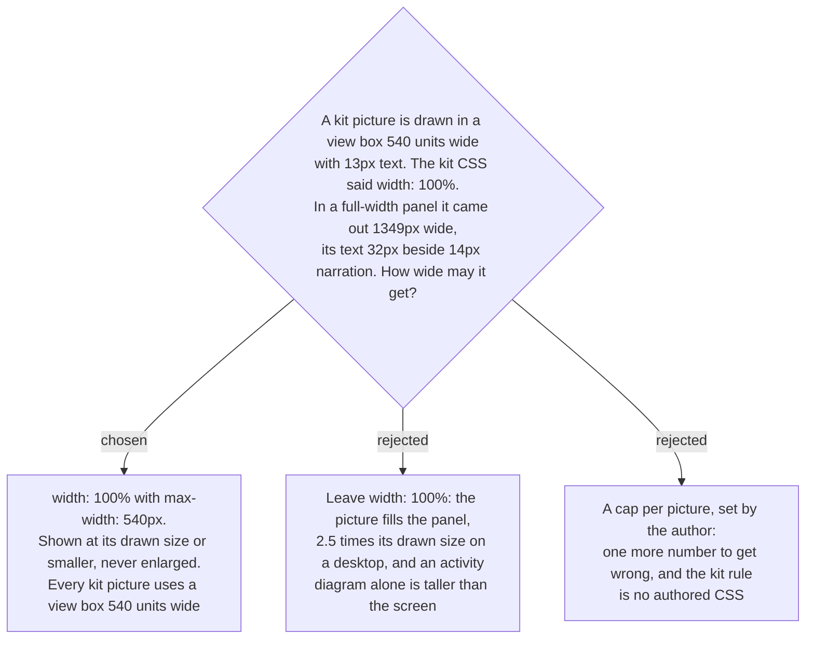

# A supporting diagram is never shown larger than it was drawn

Found by the Task 4 review, measured at 1440x900 on a diagram-mode page with both
skeletons shown: container 1385px, each picture 1349px wide (scale 2.50), picture text
32.5px, narration text 14.5px; the activity picture was 794px tall. The kit's own preview
page hid this, because its column is 560px wide.

`svg.uml` now has `max-width: 540px`. The kit's rule list says to draw in a view box 540
units wide. On a narrow page the picture still shrinks with its panel (309px wide on a
400px page). Measured after the change on the sequence demo: 540px in one column at
1024-1340px, 462-507px in the side column at 1341-1500px.
