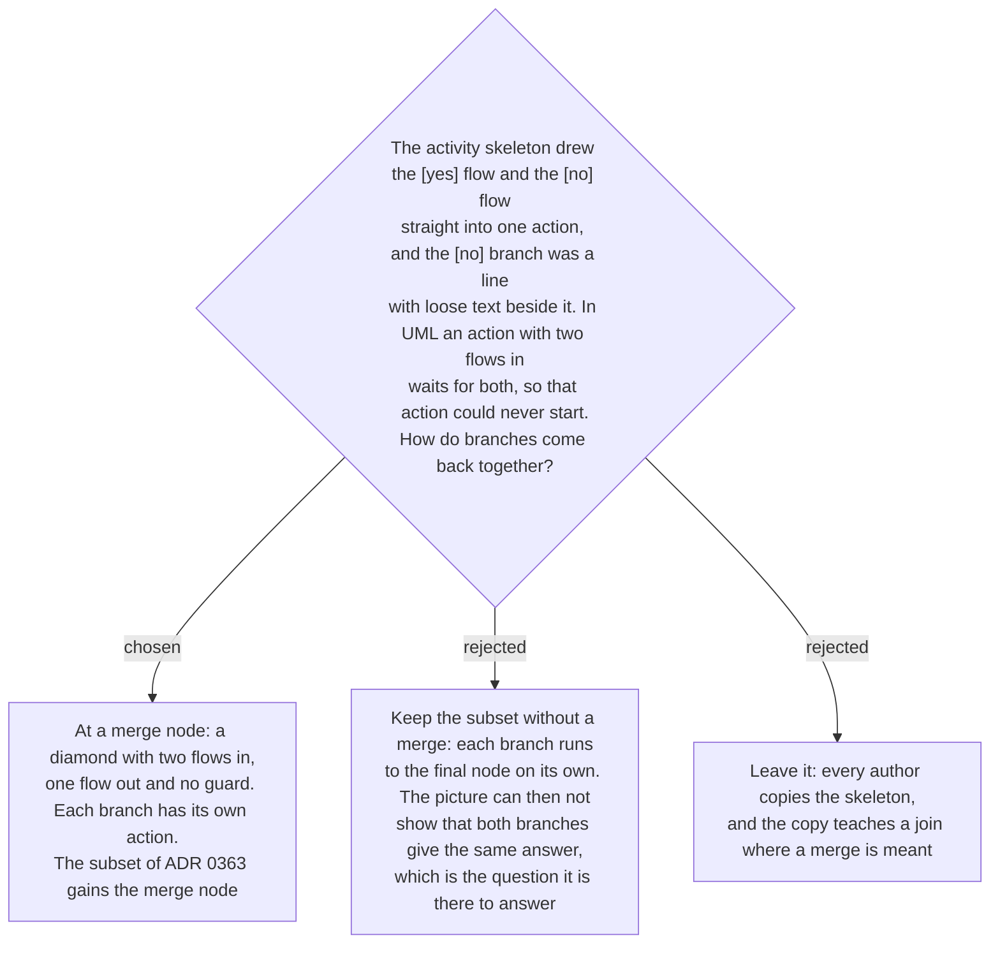

# Activity branches meet at a merge node, and each branch has an action

Found by the Task 4 review. ADR 0363 exists so that a picture that says UML on screen
follows the notation. The skeleton now reads: find the user, decide, `[yes]` make a token
and send the link, `[no]` make nothing and send nothing, merge, answer 200 OK, end. The
loose text "nothing made, nothing sent" is gone: it is the action on the `[no]` branch.

The rule is in three places an author reads: the kit's rule list, SKILL.md's notation
section and SKILL.md's pre-delivery checklist. The caption tells the reader the two
diamonds apart by their arrows: two out is a decision, two in is a merge. The sequence
demo carries the same picture. A test counts two diamonds in the activity skeleton.
