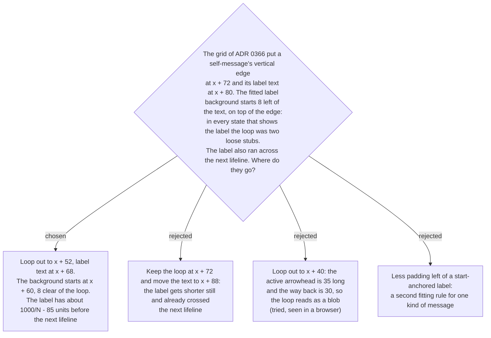

# A self-message loop is 48 wide and its label starts clear of it

Found by the Task 5 review, measured at step 5 of the demo: path
`M 379 318 L 447 318 L 447 346 L 385 346`, label background from x 445.8, covering about
83% of the edge at x 447; the background's right edge at 631.7 with the next lifeline at
625.

A self-message at row y on a lifeline at x is now
`M (x + 4) y L (x + 52) y L (x + 52) (y + 28) L (x + 10) (y + 28)` with its label text at
`x + 68, y + 19`. The demo's label is shortened to "4: make a 15-min token". Measured
after: loop edge at 427, label background from 433.8 to 594.9, next lifeline at 625. The
grid test now checks the self-message path and label position.
