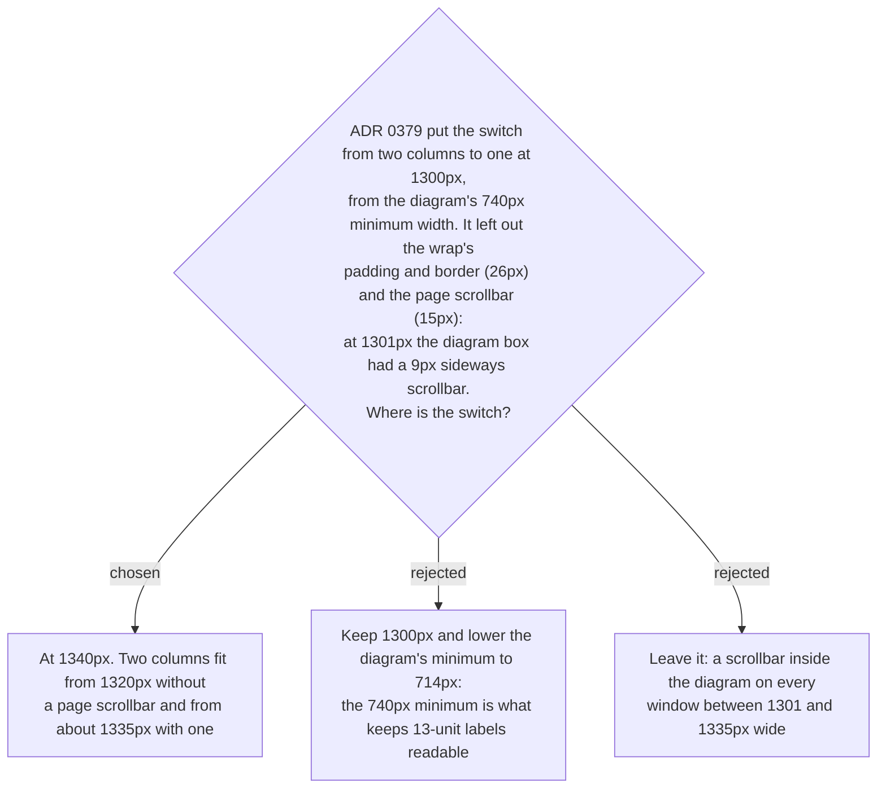

# The sequence pack goes to one column below 1340px

Found by the Task 5 review, measured at 1301px: column 756.75px, `.seq-wrap` client width
755, scroll width 764. Measured after the change: one column at 1340px and below, two
columns at 1341px with no sideways scroll in the diagram box (scroll width equals client
width at 1341, 1360 and 1500px). This replaces the number 1300 in ADR 0379; the rest of
ADR 0379 stands.
