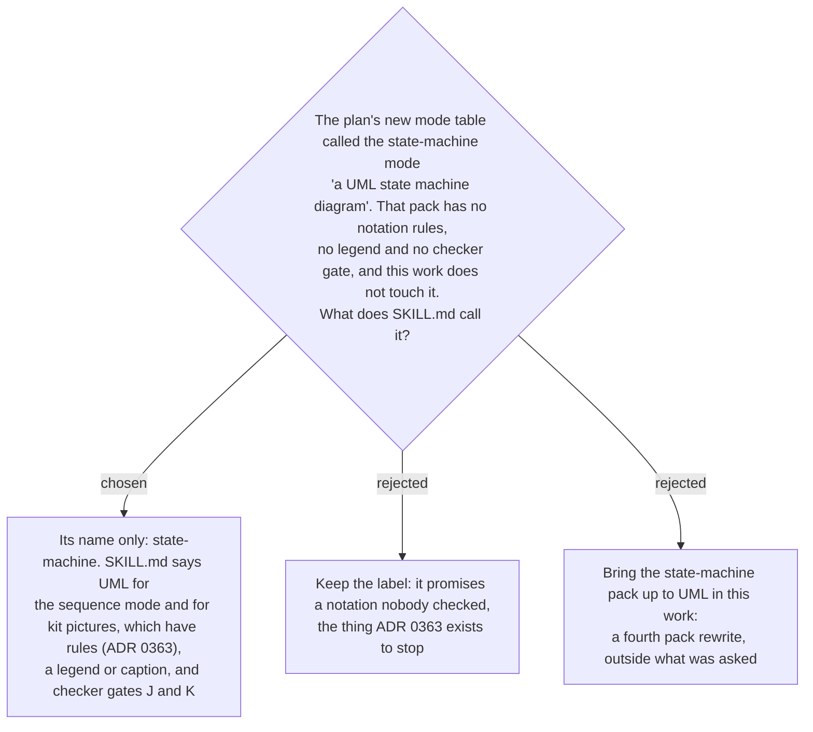

# Only a picture with a rule set and a legend is called UML

Found by the Task 6 review. A test now fails if SKILL.md says "UML state machine".
Giving the state-machine pack UML rules (initial and final state, guard syntax, a legend)
is a separate piece of work, not started.

The same review round also corrected one sentence that was wrong about the checker: an id
built as `'m' + n` does not slip past the scene-id pass, it is read as the id `m` and
fails; a template string or a variable is what slips past. SKILL.md and the checker's
comment now say so.
