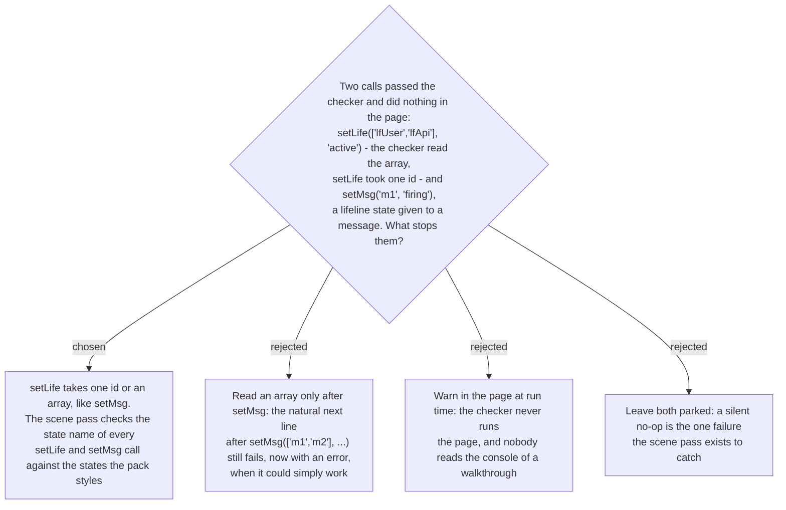

# The checker reads sequence state names, and setLife takes an array

Found by the whole-branch review, each measured on a scratch copy of the demo: with
`setLife(['lfUser', 'lfApi'], 'active')` the checker exited 0 and all four lifelines kept
the class `seq-life`; with `setMsg('m1', 'firing')` the checker exited 0 and the arrow
stayed unlit. The two state lists differ on purpose (`magic` on a message, `locked` and
`firing` on a lifeline), which makes the mix-up easy.

`setLife(ids, state)` now loops over `[].concat(ids)`. `check-walkthrough.py` has a pass
F3 beside the scene-id pass: lifeline states `active, firing, locked, blocked, done, error,
dimmed`, message states `active, done, error, magic, dimmed`, and the empty string for
both. A state built at run time is not read, the same limit as a built id. One test
with two cases covers the state check; a text test pins the setLife loop. An earlier ruling had parked the state check; this replaces it.
