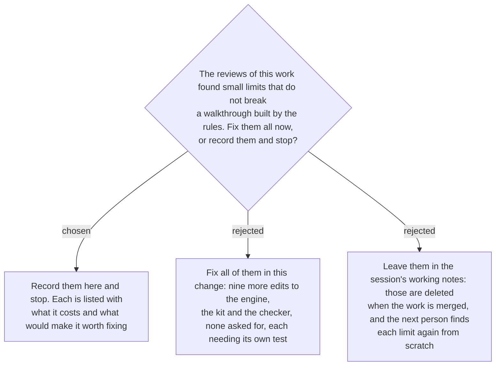

# Limits of the keyboard and UML work that were found and left

Known and accepted on 2026-11-22:

| Limit | What it costs | Worth fixing when |
|---|---|---|
| The tests and the checker read file text; nothing runs a page in a browser (ADR 0380) | a JavaScript change that keeps the asserted strings can break stepping and the suite stays green. Behaviour was measured by hand in Chromium only, not in Firefox or Safari | a regression gets through once |
| Gate J counts captions; it does not pair each caption with its picture. It reads `class="uml"` exactly and expects `data-uml` before any `>` inside an attribute | two captions on one picture and none on the next passes | an author hits it |
| The limits "12 messages", "2 to 5 lifelines" and "no width on a label background" are written rules; only the demo is tested against them | an author's page can break them unnoticed | the sequence mode gets a second real walkthrough |
| Nothing checks that a message label stays inside the view box | an over-long label is cut off at the edge | same |
| The kit's monospace font stack falls back to a proportional font on macOS; `.uml-t` omits the engine's Thai font | attribute lines look different on a Mac | someone reads a walkthrough on a Mac and minds |
| At two-column widths the sequence diagram is drawn at about 0.75 scale, so 13-unit labels are about 10px | small text on a 1341-1500px window | a reader complains; the fix is a wider one-column range |
| The Esc listener does not skip modifier chords; the step dots have no keyboard focus; an arrow key at the first or last step still cancels the browser's own scroll | none seen in use: the arrow keys cover keyboard stepping | never, unless a case appears |
| The sequence demo repeats the kit's two skeletons as markup (a test pins them equal), and the sequence pack repeats the diagram pack's state colours under its own class prefix | a palette or skeleton change is made in more than one file | the engine gets a shared state stylesheet |
| `.seq-frag-sep` (an `alt` frame's parts), `.seq-note-text` and the mirrored self-message have a written geometry but no demo and no test | the first author to use one is the first to see it | that author reports what was wrong |
| The state-machine mode has no UML rules and is not called UML (ADR 0386) | none | someone wants it to be UML |
