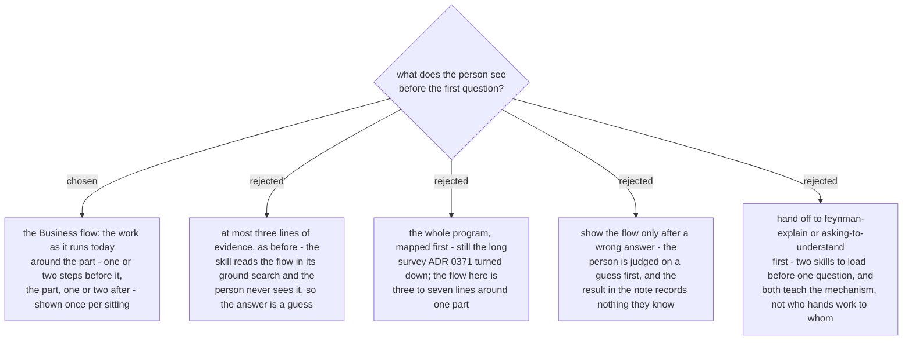

# learn-the-business shows the business flow as it is before the first question

Ruled 2026-11-23 by the user, after using the skill: "ไม่ได้สอน existing flow ก่อนถาม". The
ground search of step 1 already gave the skill the flow; only the person lacked it. The flow
is shown once per sitting, a later question repeats the one line it is about, and the flow
is shown again only when the Backward chain steps to a part that is not on it.

ADR 0371 is unchanged in what it chose - the first question is still about the part the
person is touching, and the chain still walks backward. Its rejected "mapped first" branch
stays rejected: that was a map of the whole program.

The practice this follows is current-state ("as-is") analysis before any question about
change, and showing a worked example to a newcomer before testing them. Both are named here
as *general knowledge*; no source was read for them in the session that made this ruling.
