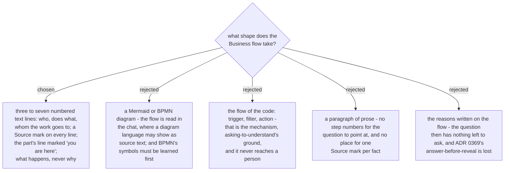

# The Business flow is plain lines of person, action and handoff, with no reason on them

Proposed by Claude and accepted by the user on 2026-11-23, with ADR 0389. The line shape -
a person, one action, a handoff - is the sentence shape of Domain Storytelling, taken as
*general knowledge*; none of that method's notation is used.

The diagram convention (ADRs 0005-0009) covers Markdown documents a skill generates. The
Business flow is chat output and is written to no file, so it is outside that convention.

A step no source states is written with `?` and the mark *assumed*, and becomes a question
for the client when the flow is shown (ADR 0373 already sends every *assumed* line there).
The person is a role in the client's business; `ระบบ` is written only where the program acts
with nobody behind it. A table name or an expression never stands in for a person - a
`path:line` appears only inside the mark.
