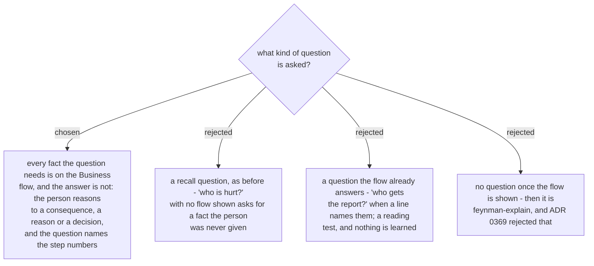

# A learn-the-business question takes its facts from the Business flow and asks for what the flow does not say

Proposed by Claude and accepted by the user on 2026-11-23, with ADR 0389. Showing the flow
makes the old questions too easy or still impossible: the ones about who and when are now
written on the picture, and the ones about why are still nowhere. The rule keeps the
question between the two.

A question that needs a fact on no line, or on a `?` line, is not asked until the fact is on
the flow. ADR 0377's single push on a system answer is unchanged, and so is ADR 0369's order:
the person answers, then the card reveals.

The claim that a learner must hold the facts before a question about them teaches anything
is *general knowledge* here; no source was read for it in the session that made this ruling.
