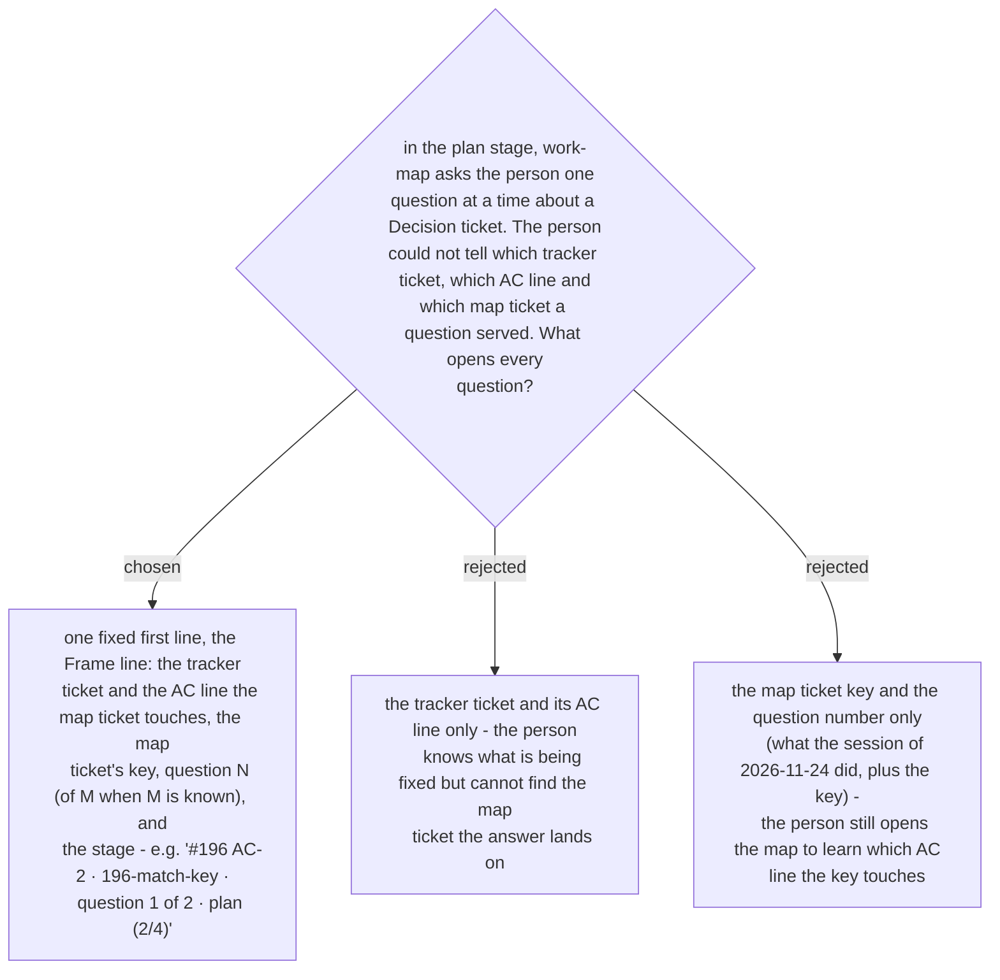

# Every plan-stage question opens with a frame line

Ruled 2026-11-24 by the user (Pon): "a", from three options the agent laid out, in a
grill-then-plan session on this problem: "งง ไม่รู้ว่า map ที่กำลังตอบคำถาม แก้ ticket ข้อไหน".

Measured on the session of 2026-11-24 09:48-11:00 (`resolve-the-ticket` on ADO #196, then
`work-map` on `196-match-key`): the person ran `/wait-what` three times (10:03, 10:27,
10:30) and asked "อันนี้คือไร" once. Every re-pitch that landed opened with a line the
question itself lacked - "We are on map ticket `196-match-key` for the daily sync (#196)".
The facts for the line already exist: every Decision ticket's Question names what it
touches ("Touches #196 AC-4"), but at the end of the paragraph, and no skill carries it to
the front of a question. Which skill writes the line, and where the "touches" fact is kept
so a cold session can build it, are later decisions of the same session.
