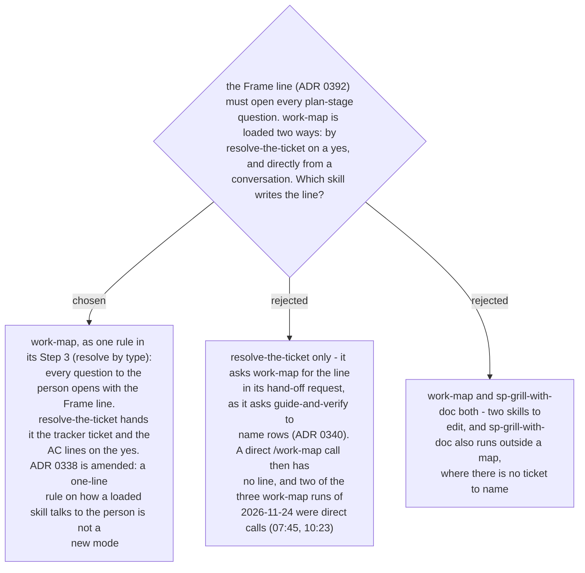

# work-map writes the Frame line on every question it asks

Ruled 2026-11-24 by the user (Pon): "a", from three options the agent laid out, in the same
grill-then-plan session as ADR 0392. The agent recommended A.

Why work-map: it is the skill that claims the Decision ticket, so it knows which ticket a
question serves whoever loaded it. The line is written once, where the question is asked,
and both entry paths get it.

ADR 0338 ("the one entry is built by changing resolve-the-ticket only") is amended, not
reversed: the entry skill is still built in resolve-the-ticket alone, and no loaded skill
gets a new mode. What a loaded skill may now get is a rule on how it speaks to the person.
