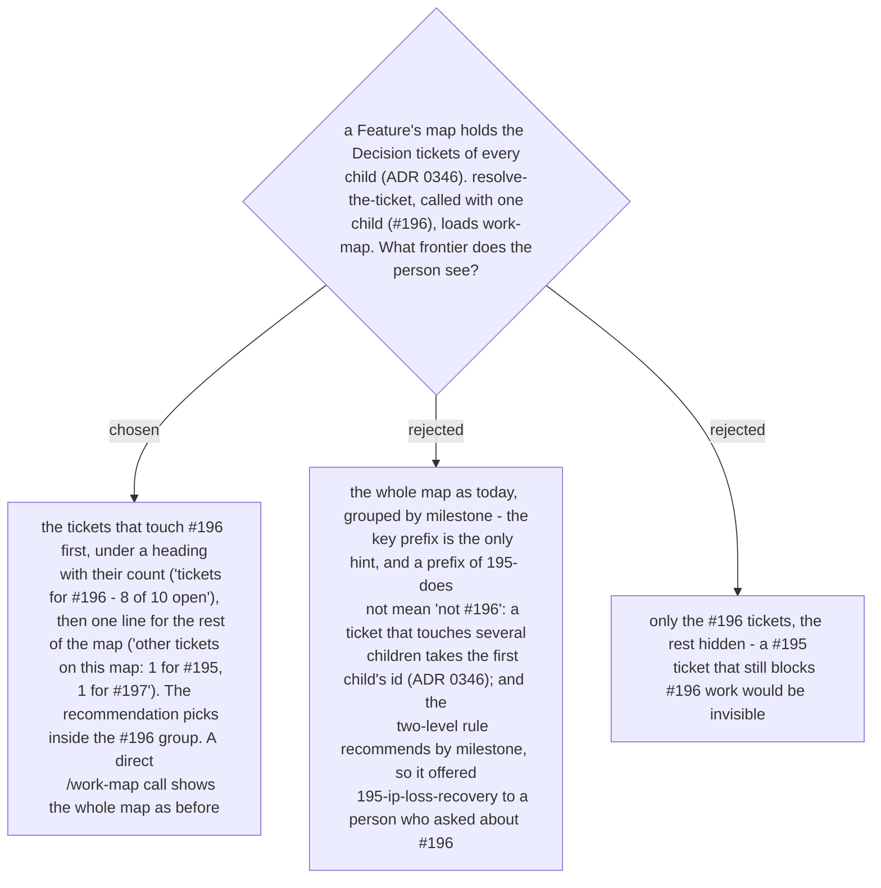

# Called for one tracker ticket, work-map lists that ticket's Decision tickets first

Ruled 2026-11-24 by the user (Pon): "a", from three options the agent laid out, in the same
grill-then-plan session as ADRs 0392 and 0393. The agent recommended A.

Measured on the session of 2026-11-24 10:00: `resolve-the-ticket` was called with #196 and
`work-map` listed four milestones with tickets of #195, #196 and #197 together; three
minutes later the person ran `/wait-what`. A ticket belongs to the #196 group when its
Question's "Touches …" sentence names #196 (ADR 0395), so a ticket that touches several
tracker tickets appears in each one's group - accepted. resolve-the-ticket hands the tracker
ticket's number to work-map on the yes; without it (a direct call) work-map has no group to
form and shows the map as before.
