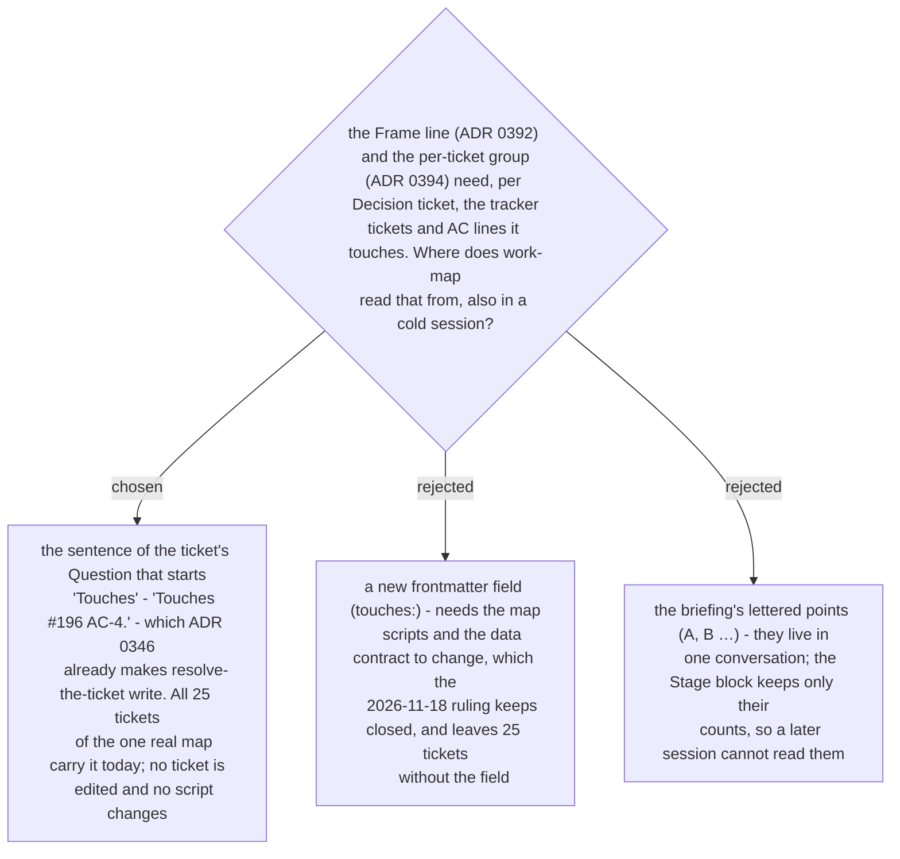

# The "Touches" sentence of a Decision ticket's Question is the source of the Frame line

Decided 2026-11-24 by the agent from the files, said to the user (Pon) in the same
grill-then-plan session as ADRs 0392-0394, with no objection. Measured on
`docs/decision-map/ado-193-ips-api-feed/tickets/` (25 files): every Question ends with a
"Touches …" sentence; 20 name an AC line or another item, 5 name the ticket alone
("Touches #196."). A ticket whose sentence names no AC line gets a Frame line with the
tracker ticket only. A ticket with no "Touches" sentence at all (a map not charted through
resolve-the-ticket) gets the Frame line without the tracker part: the key, the question
number and the stage. resolve-the-ticket keeps writing the sentence as ADR 0346 says; it
is the one place the fact lives.

## Amendment — 2026-11-24: the line writes the sentence as it is; the caller's ticket drives only the group

The whole-branch review of the Frame line branch found that a filter "the caller's ticket only" (a Task 1 ruling of the same day) wrote the wrong ticket on a Feature's URL, whose `for #193` no sentence names, and on any ticket picked outside the group. The landed rule: the line always writes what the `Touches` sentence names, as it has them; a ticket with no sentence gets the ticket the caller named, or no tracker part on a direct call; the caller's ticket drives only the group and the counts (ADR 0394). A ticket `work-map` graduates from fog gets its sentence from the ticket whose answer cleared it.
