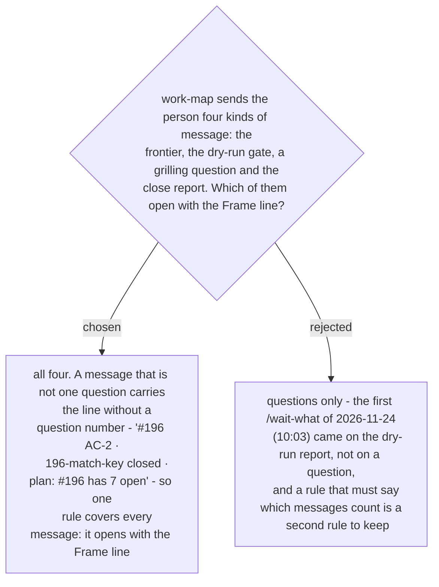

# Every work-map message to the person opens with the Frame line, not only a question

Ruled 2026-11-24 by the user (Pon): "a", from two options the agent laid out, in the same
grill-then-plan session as ADRs 0392-0395. The agent recommended A.

The line's parts stay those of ADR 0392; "question N of M" is present only on a question,
and "of M" only when the asker knows M. On the frontier and the close report the tracker
part is the ticket the session was called for (ADR 0394) when there is one.
