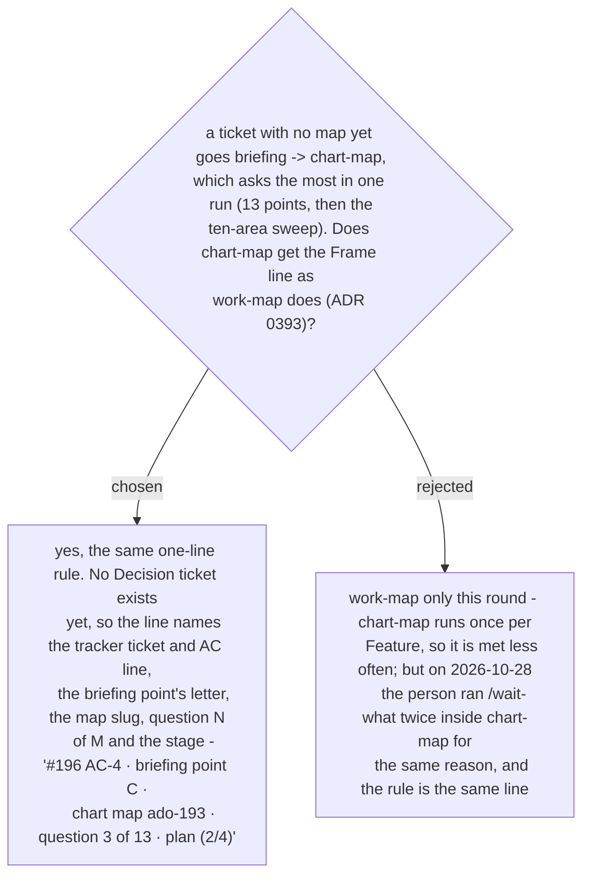

# chart-map opens its messages with the Frame line too, naming the briefing point

Ruled 2026-11-24 by the user (Pon): "a", from two options the agent laid out, in the same
grill-then-plan session as ADRs 0392-0396. The agent recommended A; the cost accepted is a
third skill edited (resolve-the-ticket, work-map, chart-map).

For the line to be writable, resolve-the-ticket hands chart-map each point with its letter
and its locator ("#196 AC-4") on the yes - the same facts it already turns into the
Decision ticket's "Touches" sentence (ADRs 0346, 0395). A chart-map run started directly,
with no briefing behind it, has no letters: the line then carries the map slug, the question
number and the step (destination, frontier, sweep).
