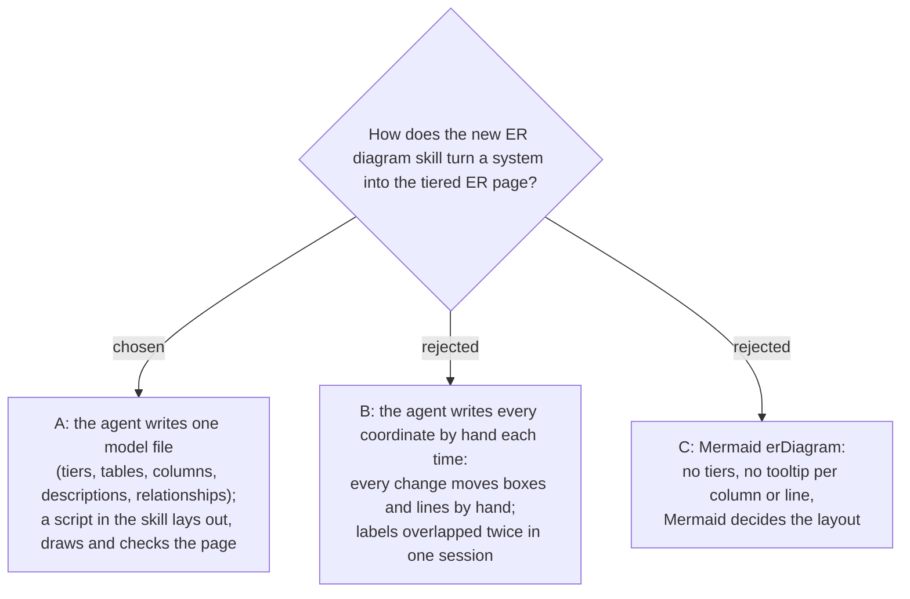

# The ER diagram skill draws from a model file through a bundled script, not by hand

Status: accepted (Pon, 2026-11-26, "a").

The skill is made from a tiered data model page drawn for a client project (kept off this public
repo, ADR 0409), whose SVG was drawn by a hand-written Python file with fixed x/y for every box
and line. When one table changed its key, the rows moved and every line into that table had to be
re-placed by hand; label overlaps happened twice in that session. So the agent writes only the
content (it reads the source, writes descriptions and multiplicities) into one model file, and a
script in the skill computes the positions, draws the page and checks it: every table has its row
meaning and purpose, every relationship has a label, a tooltip and both multiplicities, and no
label or line overlaps another. The cost: the layout follows the script's rules, so it is less
free than drawing by hand.
