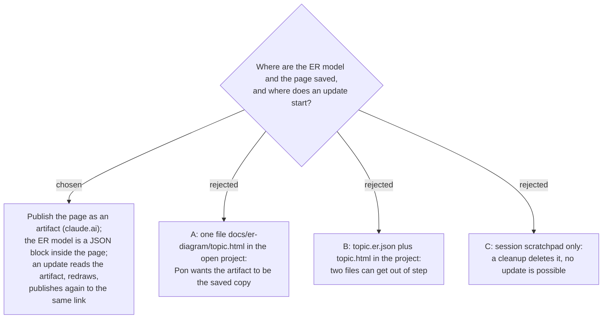

# The ER page, with its ER model inside, is saved as a published artifact, not as a file in the project

Status: accepted (Pon, 2026-11-26, "save on artifact of claude").

The ER model (ADR 0398) is written into the page as a block that the browser does not run
(`<script type="application/json" id="er-model">`), and the page is published as an artifact.
The published artifact is the saved copy: the skill writes no file into the user's project, and
its working files are temporary. To update a page, the agent gets the artifact (from the link the
user gives, or by the page title in the user's artifact list), the script takes the ER model out
of the page, the agent changes only what changed, the script draws and checks the page again, and
the agent publishes it to the same link. The reason: the page the readers open is the one copy, so
the model cannot be older than the page, and an update works from any PC with the link. On
2026-11-26 the generator of the page this skill is made from was only in a session scratchpad and
was nearly lost.

Consequences:
- The skill text stays harness-neutral (repo CLAUDE.md): "publish the page where your harness
  publishes HTML pages, and keep its link". A harness with no such mechanism saves the page to
  `<open project>/docs/er-diagram/<topic>.html` and gives the full path; an update then starts
  from that file (confirmed by Pon in the design recap, 2026-11-27).
- The project's git history does not show the page or its changes; the artifact's own version
  history does.
