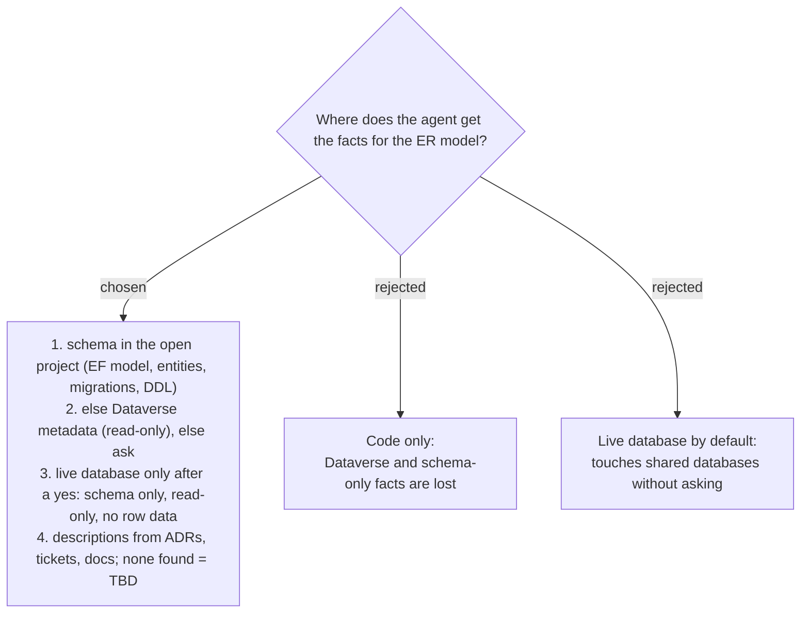

# ER model facts come from the code and the metadata; a live database only after the user says yes; a missing fact is TBD

Status: accepted (Pon, 2026-11-26, "yes").

The agent fills the ER model in this order: names, types, keys and foreign keys from the schema
in the open project (EF model builder, entity classes, migrations, SQL DDL); if there is none, the
table metadata of Dataverse through its Web API (read-only); if neither, it asks the user where the
schema is. A live database is read only after the user says yes, and then only its schema
(read-only), never row data. The description, row meaning ("1 แถว =") and purpose of each table
and column come from ADRs, tickets and docs; when no source states one, the value is `TBD`, never
an invented value (the Source-or-TBD rule of `sa-doc`). Worked example (the made-up Bookshop order
sync, ADR 0409): the `order_line` key comes from the project's EF model builder, its row meaning
from the ADR that chose that key, and the database container is never read.

Consequence: the script's check lists every `TBD` left in the model, so the user sees what is
unknown before the page is published (decided in ADR 0405).
