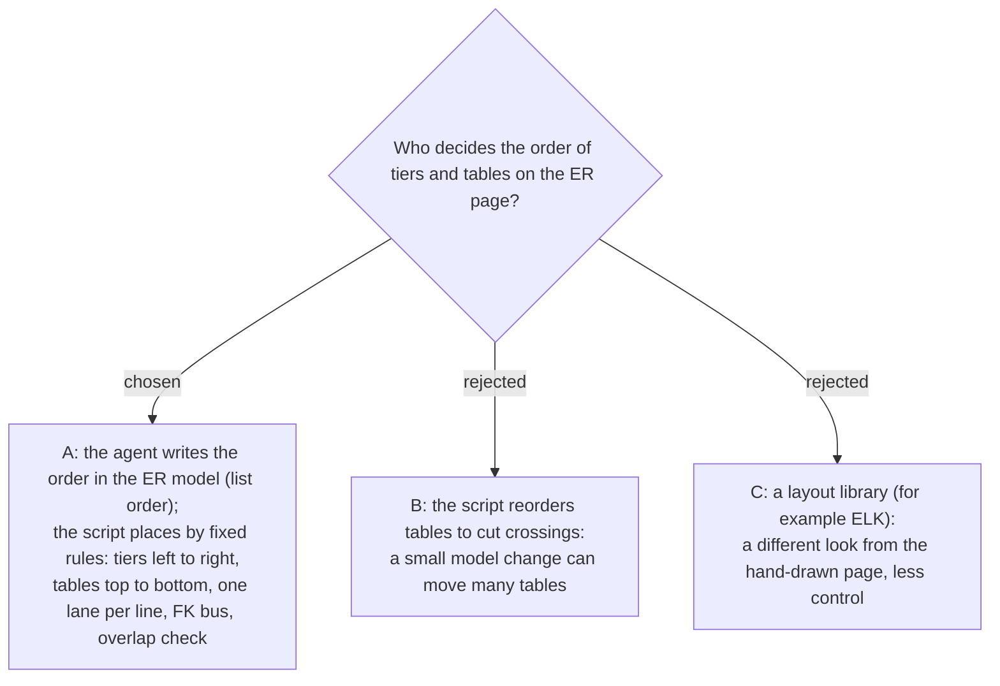

# The ER page layout follows the order in the ER model, with fixed tier and lane rules

Status: accepted (Pon, 2026-11-26, "a").

The script keeps the look of the hand-drawn page the skill is made from (ADR 0398) and computes
every position from the ER model's list order. Rules:

1. Tiers are columns from left to right, in model order; each is a band with a title and a subtitle.
2. Tables in a tier go from top to bottom, in model order.
3. Each line between two tiers gets its own vertical lane in the gap between them; two lines share
   a lane only when their vertical spans do not overlap.
4. Many foreign keys to one table share one bus line; lines inside one tier use lanes at the right
   edge of that tier.
5. Each end of a line attaches at the row of the joined column; the label sits on the last
   segment; a multiplicity sits at each end.
6. If a label or a line overlaps another, the script widens the gap (more lanes) and draws again.

Worked example (the made-up Bookshop order sync, ADR 0409): tier `shop_raw` lists `raw_orders`,
`raw_order_lines`, `raw_deletions`, `raw_customers`; their same-value lines to tier `shop` each get
a lane, and their four foreign keys to `sync_run` share one bus. The agent writes only that order;
the script computes the numbers.

Consequence: to change the picture, the agent changes the order in the model, never a position.

Amendment (Pon, 2026-11-27, spec approval): rule 2 is refined. A box that has a line to a box in
the next tier on its right is placed level with that box when the place is free; otherwise it goes
below the box above it. The hand-drawn page does this: each endpoint sits level with its raw table,
so the "Land" lines are straight. Without it, all endpoints stack at the top of their tier.
