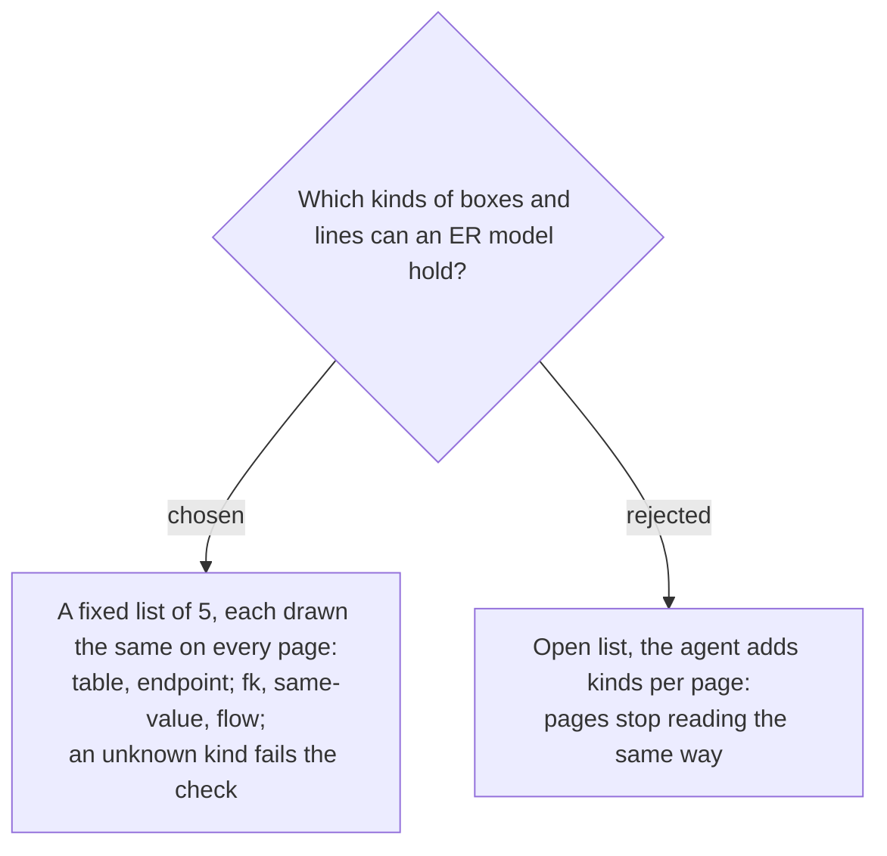

# The ER model has a fixed list of kinds: two boxes (table, endpoint) and three lines (fk, same-value, flow)

Status: accepted (Pon, 2026-11-26, "yes").

The five kinds are the ones the hand-drawn page uses (ADR 0398); the examples are from the made-up
Bookshop order sync (ADR 0409):

| Kind | Drawn as | Meaning | Example |
|---|---|---|---|
| `table` | box with columns (name, type, key, description) | a database table | `shop.order` |
| `endpoint` | box with an accent border, two text lines, no columns | a source that is not a table: an API, a file, a queue | `OrderLinesChanged` |
| `fk` | solid line | a real foreign key in the database | `SyncRunId = RunId` |
| `same-value` | dashed muted line | the same value joins two tables, with no foreign key | `SourceId = OrderId` |
| `flow` | accent line with an arrow and a bold label | data moves or is computed, not a key | "Land"; "count books" |

The script's check fails on a kind not in this list, and the page is not drawn. The legend shows
only the kinds a page uses. A new kind (for example a view) is a change to the skill with its own
ADR, never a one-page invention.
