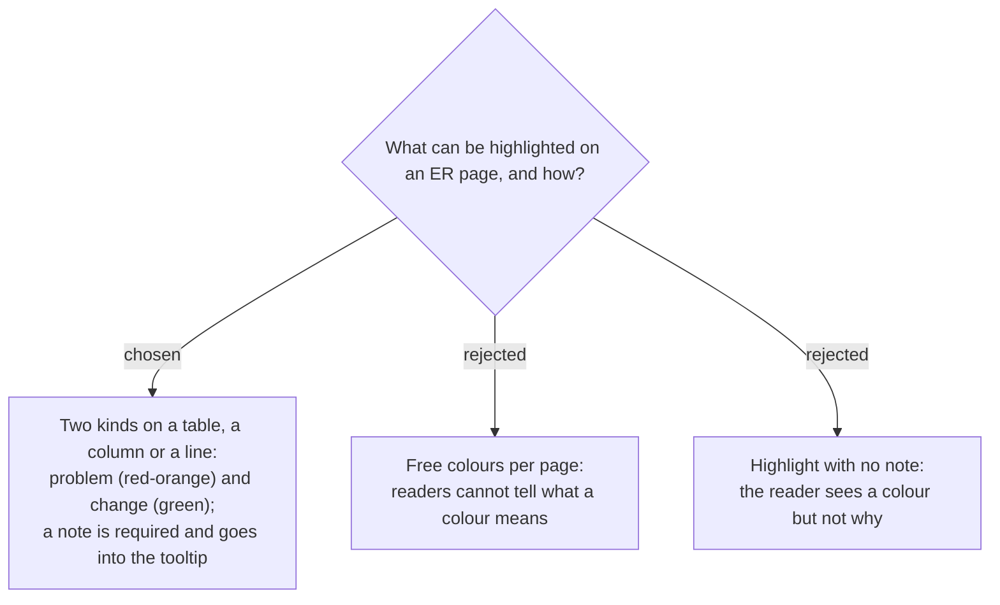

# An ER highlight is problem or change, and each highlight needs a note

Status: accepted (Pon, 2026-11-26, "yes").

A table, a column or a line in the ER model can carry one highlight: `problem` (colour `--bad`,
`#a8492a` light / `#e58a65` dark) or `change` (colour `--good`, `#2d7a4c` light / `#72c595`
dark), the two colours of the hand-drawn page (ADR 0398), where one version marked a problem line
and the next version marked the fix. Each highlight has a short note; the check fails on a
highlight without a note. The script draws the highlight in the kind's colour (box border, row
text, line, label, multiplicities), puts the note into the item's tooltip, and the legend shows the
highlight kinds the page uses. One page can have both kinds.

Worked example (the made-up Bookshop order sync, ADR 0409): first `problem` on the line
`raw_order_lines` -> `order_line` (a key of order + book keeps one row for two lines of the same
book); after the fix, that highlight is removed and `change` goes on table `order_line` and column
`LinePk`. Both pages come from the same model with that one difference.
