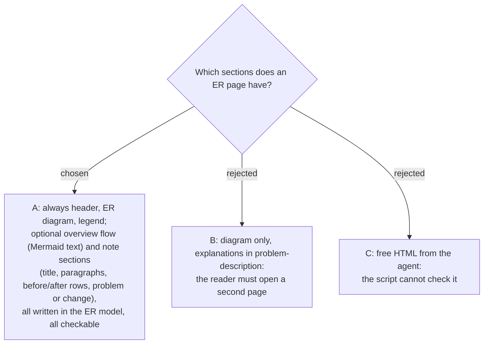

# An ER page has fixed sections: header, diagram and legend always; an overview flow and note sections when the model has them

Status: accepted (Pon, 2026-11-26, "a").

The page is built in this order from the ER model:

1. Header: eyebrow line, title, intro (always).
2. Overview flow: a "how the data flows" section from Mermaid text in the model (only if given).
3. ER diagram and legend; the legend lists only the box, line and highlight kinds the page uses
   (always).
4. Note sections, in model order. Each has a title and paragraphs, an optional before/after block
   with sample rows, and a kind (`problem` or `change`, ADR 0403) that sets its colour.

The agent never writes HTML into the model; every section has a fixed shape that the script checks.
The hand-drawn page (ADR 0398) had exactly these four parts.

Worked example (the made-up Bookshop order sync, ADR 0409): eyebrow "Bookshop · order sync";
the overview flow Shop API -> `shop_raw` / `shop` -> CRM; the four-tier diagram; one `change` note
section "order_line: one row per shop line" whose before block holds raw lines L-1 and L-2 that
give one row, and whose after block holds two rows, L-1 (false) and L-2 (true).
