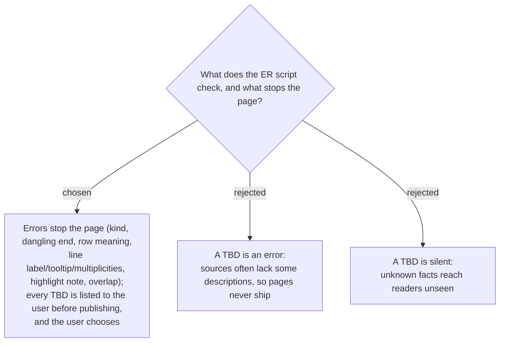

# ER check: errors stop the page; a TBD is a warning that the user sees before publishing

Status: accepted (Pon, 2026-11-26, "yes").

Errors (the script lists every error with the item name and draws no page; the agent fixes the
model and runs again):

1. A box or line kind not in the list of ADR 0402.
2. A line end that names a table or column not in the model.
3. A table without a row meaning ("1 แถว =") or a purpose.
4. A line without a label, a tooltip, or a multiplicity at either end.
5. A highlight without a note (ADR 0403).
6. A label or line that still overlaps another after the gap is widened (ADR 0401).

Warning: every value left as `TBD` (ADR 0400) is listed (item and field) to the user before the
page is published; the user chooses to publish now or to give the facts first. This settles the
proposed consequence in ADR 0400.

Worked example (the made-up Bookshop order sync, ADR 0409): a missing multiplicity at the
`customer` end of `raw_customers` -> `customer` stops the run with "line raw_customers→customer:
no multiplicity at end customer"; no source describing `order.Status` gives the warning
"order.Status: desc TBD", and the page is still drawn.
