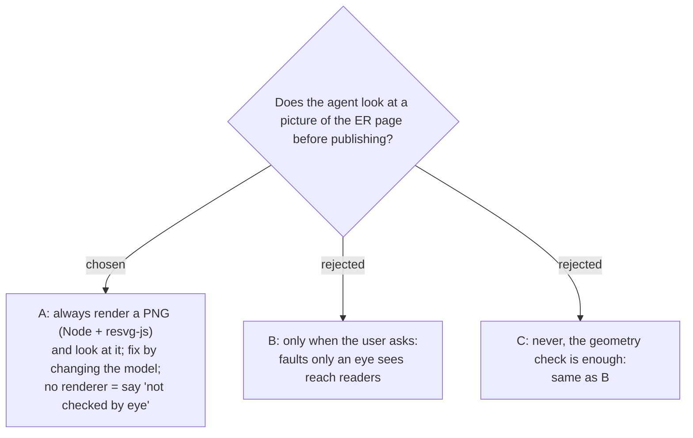

# The ER page is checked by eye on a PNG before publishing, when a renderer is available

Status: accepted (Pon, 2026-11-27, "a").

The geometry check of ADR 0405 cannot see everything (a label too close to a line, a box too
dense). So after the script draws the page (Python, standard library only), it renders a PNG with
Node and `@resvg/resvg-js` (2.6.2 worked on 2026-11-26; installed with `npm install` in a temporary
folder, no admin rights), and the agent looks at it. A fault is fixed by changing the ER model
(order, label text), never a coordinate (ADR 0401), and the page is drawn again. If Node or
resvg-js is not available, the agent publishes and reports "not checked by eye: no PNG renderer".
Headless Edge is not used: it hangs on Pon's PC.

Evidence: label overlaps happened twice while the page this skill is made from was drawn by hand
on 2026-11-26 (ADR 0398); the PNG renders made with resvg-js were used to see the page there.
