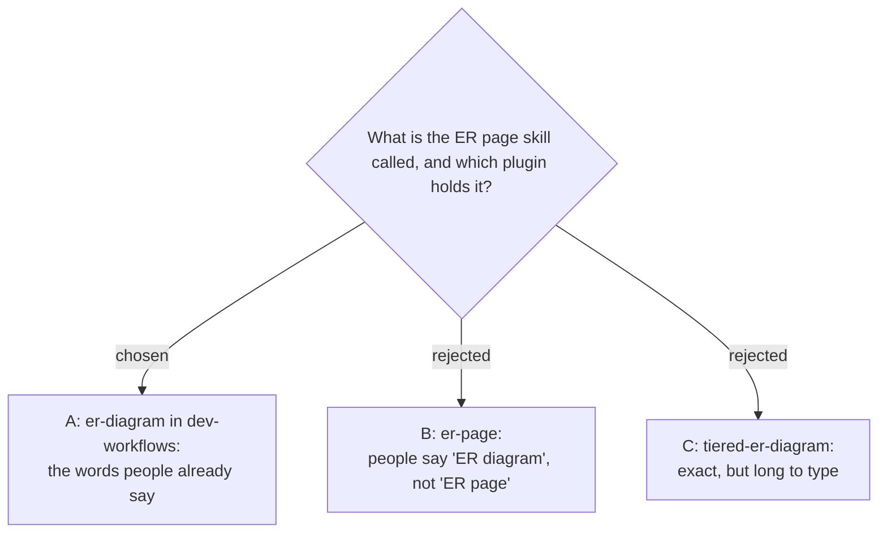

# The ER page skill is named er-diagram, in the dev-workflows plugin

Status: accepted (Pon, 2026-11-27, "a").

The skill is `plugins/dev-workflows/skills/er-diagram/`, invoked as `/dev-workflows:er-diagram`
or by requests such as "ทำ ER diagram ของ order sync", "data model page", "update the ER page
<link>". It sits next to `problem-description` and `sa-doc`, the other page-making skills of the
plugin. No skill in the six plugins had this name on 2026-11-27. The PLAYBOOK gets one table row
("need an ER page of a system's tables" -> `er-diagram`) and one router arrow, in the commit that
adds the skill (repo CLAUDE.md).
