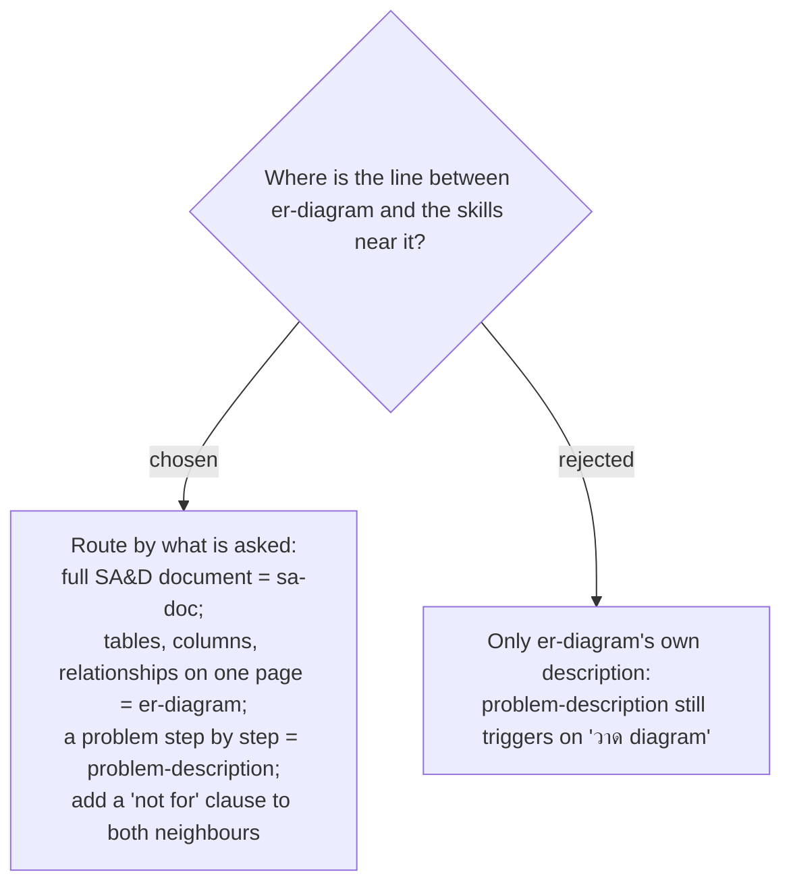

# er-diagram's boundary: sa-doc for a full SA&D document, problem-description for a step-by-step problem, both told about er-diagram

Status: accepted (Pon, 2026-11-27, "yes").

Routing, in this order:

1. A full SA&D document (use cases, screens, data dictionary ...) -> `sa-doc`, which keeps its own
   `erDiagram` inside the document.
2. The tables, columns and relationships of a real system, on one page -> `er-diagram`.
3. A problem explained step by step with data -> `problem-description`, even when it shows tables.
4. Anything else -> a general diagram, answered directly.

The overlap is real: `problem-description` triggers on "ทำเป็น diagram" and "วาด diagram", so
"วาด ER diagram ของ order sync" could reach it. So the commit that adds `er-diagram` also adds one
clause to each neighbour's description: `problem-description` "not for an ER page of a system's
tables (er-diagram)"; `sa-doc` "not for a single ER page (er-diagram)". `er-diagram` states rules
1-4 in its own "Do NOT use" line.

Worked examples: "ทำ ER diagram ของ shop กับ shop_raw" -> `er-diagram`; "อธิบายทีละ step ว่าทำไม
หนังสือหายจาก CRM order" -> `problem-description`; "ทำเอกสาร SA ของระบบ" -> `sa-doc`.
