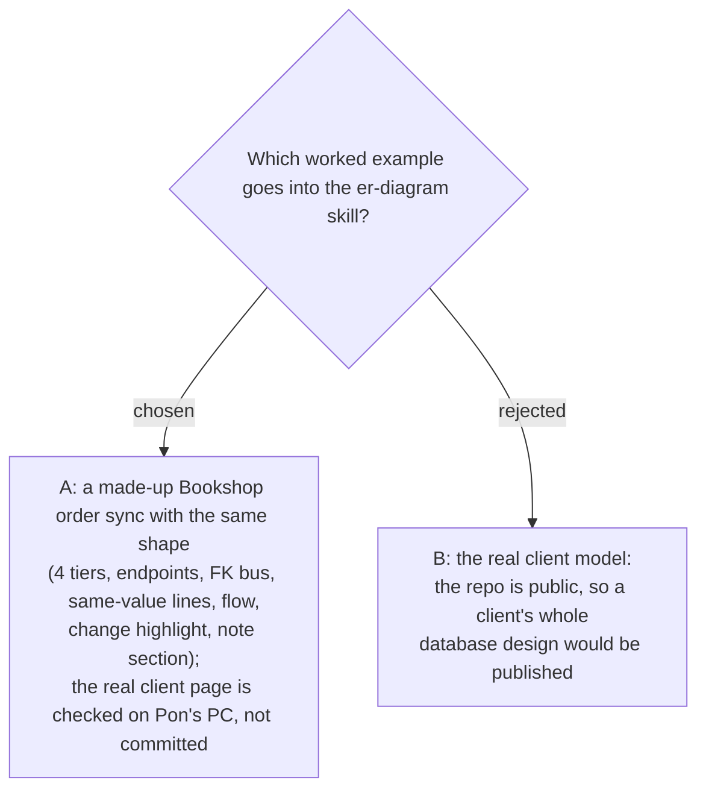

# The er-diagram example in the repo is made up; the real client model stays on Pon's PC

Status: accepted (Pon, 2026-11-27, "a").

`workflow-daily-work` is a public GitHub repo (`gh repo view`: `"visibility":"PUBLIC"`, measured
2026-11-27). The page the skill is made from shows a client's whole internal database design
(every table and column of three schemas, the CRM prefix, ticket and pull-request numbers,
people's names). So the skill's example and its test input are a made-up "Bookshop order sync"
with the same shape: shop API endpoints -> raw tables -> current tables -> a CRM row, an FK bus
from the raw tables to `sync_run`, same-value lines (two from one row), lines inside one tier, a
flow arrow, one `change` highlight with its note, one note section with before/after rows, and an
overview flow. The real client model is kept outside every repo, in Pon's reference folder, and
the check "the real page builds with no error and its PNG looks right" is run there by hand before
the skill is called done; its result is reported without the client's data.

Rule for this skill from now on: a file committed to this repo for `er-diagram` holds no client
schema, names or ticket numbers.
