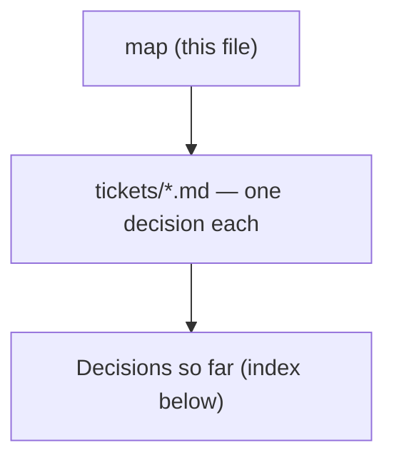

# Decision map - resolve-the-ticket as the one entry for working a ticket

## Destination
Calling resolve-the-ticket with a ticket URL carries the ticket through its whole line - briefing, planning by loading chart-map / work-map, doing and verifying by loading guide-and-verify, then the check - and each method's text stays only in its own skill, so a change is made in one place.

## Notes

<!-- decision-map:notes:start -->
- No new skill and no copied text between skills: the entry skill only says which skill to load at which stage (user, 2026-11-18).
- Another session has uncommitted edits to guide-and-verify; read its SKILL.md fresh before deciding anything about it.
- resolve-the-ticket's current rules are ADRs 0316-0333, 0335, 0336; ADR 0316 (builds nothing) and ADR 0317 (asks briefing or check) are the two this map will most likely amend.
- sweep 2026-11-18: none - performance, operations; ticket - stage-model, cross-plugin-loading, plugin-missing, resume-after-break, acting-rule, who-did-what, repo-data-rules; fog - functional; out of scope - scope
- Only resolve-the-ticket may be edited; guide-and-verify, chart-map, work-map and every other skill are loaded as they are (user, 2026-11-18, ADR 0338).
<!-- decision-map:notes:end -->

## Milestones

<!-- decision-map:milestones:start -->
- `do-and-verify` one ticket walks briefing -> do and verify -> check in one call [stage-model, acting-rule, code-work-stage, gav-contract, resume-after-break, who-did-what]
- `plan-with-map` the planning stage runs on a decision map [map-trigger, which-map, decision-store, one-session-stop, plugin-missing, cross-plugin-loading, repo-data-rules]
<!-- decision-map:milestones:end -->

## Decisions so far

<!-- decision-map:decisions:start -->
#### do-and-verify — one ticket walks briefing -> do and verify -> check in one call (6/6 closed)

- [Acting - what replaces 'builds nothing'?](tickets/acting-rule.md) — It does not act itself: every act happens in the skill it loads, under that skill's rules, and it loads a skill only on the person's yes - also for a gap after NOT READY.
- [Code-only work - what does the do stage load when no one has to click?](tickets/code-work-stage.md) — Code work loads sp-writing-plans with the ticket's AC lines as requirements, then its executing skill; the tests it leaves are the proof the check reads.
- [guide-and-verify - what must it write so the check can read it?](tickets/gav-contract.md) — guide-and-verify writes nothing new: the check reads its own step fields; the entry hands it the row list, and the runbook is made when the do stage starts.
- [Reliability - the session dies in the middle of a stage: what then?](tickets/resume-after-break.md) — The entry reads the loaded skill's own record - runbook outcome lines, or plan, ledger and git log - and a step with no result is measured before it is done again.
- [Stages - which stages does a ticket have, and how does a run know where it is?](tickets/stage-model.md) — Four stages - briefing, plan, do and verify, check; on each call the skill reads the runbook, proposes the next stage with one line of evidence, and asks once.
- [Identity - how is it recorded who did each step and who approved each decision?](tickets/who-did-what.md) — No gathered record is added: who did a step stays in each skill's own record, and the check table and closing comment stay as they are.

#### plan-with-map — the planning stage runs on a decision map (3/7 closed)

- [Research - does loading a skill from another plugin work in every install?](tickets/cross-plugin-loading.md) — A skill name reaches another plugin's skill only when both are installed side by side; the tooling passes the name through untouched, and no channel has a live test on record.
- [Planning - when does a ticket open or touch a decision map?](tickets/map-trigger.md) — Open points of group 1 (as task tickets) and group 2 (as grilling tickets) go on a Decision map through chart-map; when both are empty the plan stage is skipped, said in one line.
- [Which map - the project's map, or one per ticket?](tickets/which-map.md) — One map per Feature, shared by all its children; a ticket with no Feature above it gets its own map; folder and ticket keys carry the tracker numbers.
<!-- decision-map:decisions:end -->

## Not yet specified

<!-- decision-map:fog:start -->
- A Feature with several child tickets (like #193 with #194-#197): how does it walk this line - one run per child, or one run for the family?
<!-- decision-map:fog:end -->

## Out of scope

<!-- decision-map:scope:start -->
- A new skill that orchestrates the three - the user ruled it out: more places to maintain.
- Copying another skill's method text into resolve-the-ticket.
- The skill writing to the tracker itself (comment, State, ticked AC) - ADR 0318 stands.
- Editing any skill other than resolve-the-ticket - no new mode for guide-and-verify, chart-map or work-map (ADR 0338).
<!-- decision-map:scope:end -->
