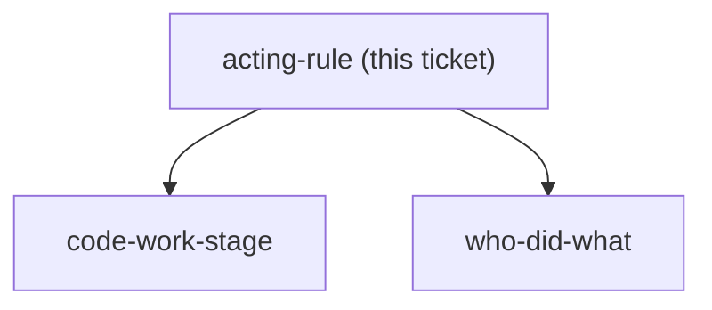
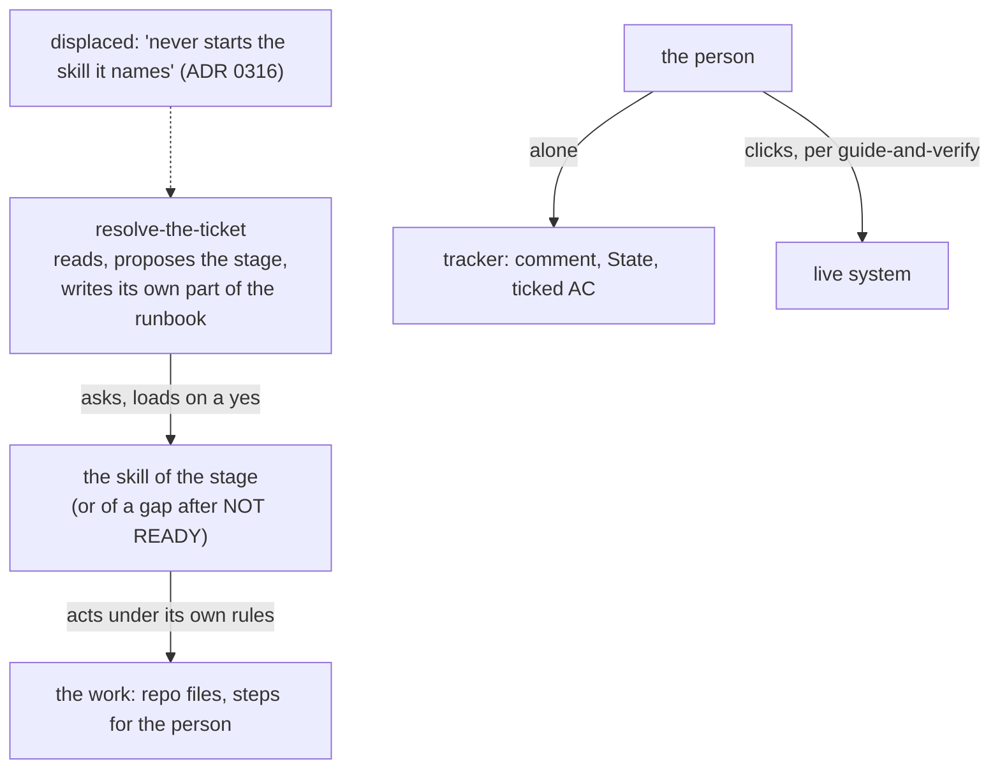

## Question

ADR 0316 says resolve-the-ticket builds and fixes nothing. As the one entry it will lead work. May it act itself, or only through a skill it loads - and which acts stay a person's alone (the tracker, a live system the agent may only read, guide-and-verify's 'who acts' boundary)?

<!-- decision-map:graph:start -->

<!-- decision-map:graph:end -->

<!-- decision-map:resolution:start -->
## Resolution

It does not act itself: every act happens in the skill it loads, under that skill's rules, and it loads a skill only on the person's yes - also for a gap after NOT READY.

Detail: docs/adr/workflow-daily-work-0339-resolve-the-ticket-leads-the-work-but-acts-only-through-the-skill-it-loads.md

Confirming exchange, 2026-11-18:

- Acting: the user picked "A. ไม่ลงมือเอง" over acting in the repo itself, and over acting wherever it has access.
- After NOT READY: the user picked "1. เสนอ แล้วโหลดเมื่อตอบใช่" over naming the skill and stopping.

"Builds nothing" still holds for the entry skill itself; only "never starts the skill it names" changes.

<!-- decision-map:resolution:end -->
