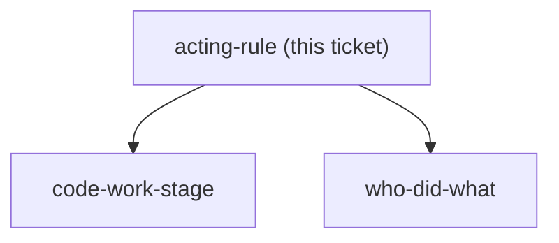

## Question

ADR 0316 says resolve-the-ticket builds and fixes nothing. As the one entry it will lead work. May it act itself, or only through a skill it loads - and which acts stay a person's alone (the tracker, a live system the agent may only read, guide-and-verify's 'who acts' boundary)?

<!-- decision-map:graph:start -->

<!-- decision-map:graph:end -->
